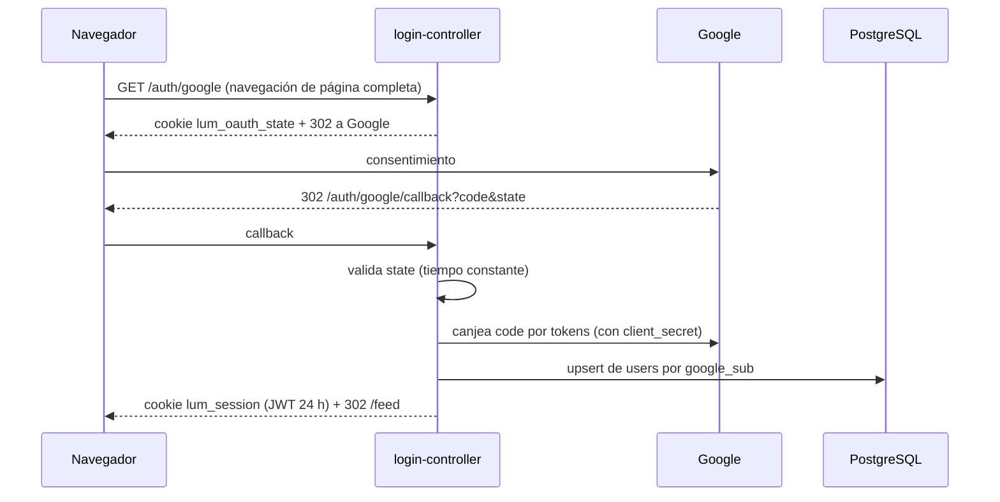
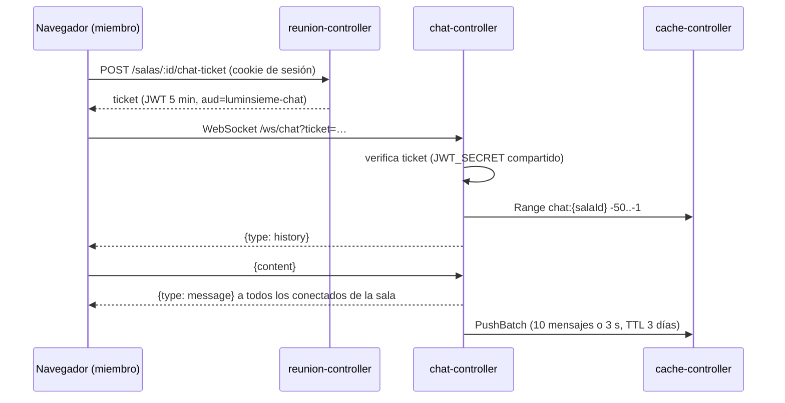

# LumInsieme — Contexto integral del proyecto

> **Documento fuente para generar documentación.** Reúne el objetivo, la evolución, la arquitectura, los flujos, la persistencia y el estado real del sistema al **20 de octubre de 2026**. Está pensado para que otra IA lo use como base y produzca la documentación final del proyecto.

## 0. Instrucciones para la IA que lea este documento

1. **Distinguí lo implementado de lo planificado.** La especificación original (`docs/Especificiaciones.md`) describe módulos que hoy **no existen o fueron descartados** (sistema de recomendación, Grafana, carpeta `backend/`). Este documento indica en cada caso si algo está *implementado*, *pendiente* o *descartado*.
2. **El alcance vigente lo define la resolución del 28/09/2026** (sección 2). No documentes como funcionalidad la recomendación por gustos ni Grafana.
3. **No inventes datos.** Si algo no figura acá ni en las fuentes de la sección 15, marcalo como "a confirmar".
4. **Terminología:** en el código y en la interfaz, un *evento* se llama **sala**. Una *función* es una proyección concreta (película + horario + formato + cine). Ver el glosario (sección 14).
5. **Idioma:** el proyecto se documenta en español rioplatense (voseo en la interfaz).

---

## 1. Resumen del proyecto

| Campo | Detalle |
| :--- | :--- |
| **Nombre** | LumInsieme |
| **Qué es** | Plataforma web para que aficionados al cine de todo el país armen salidas grupales al cine |
| **Contexto académico** | Ingeniería en Informática, 5.º ciclo, 1.er cuatrimestre. Asignatura *Habilitación Profesional A*, trabajo *Herramientas de Software*. Docentes: Enrique Reinoso y Belén Piedrabuena |
| **Equipo** | Audrey Virginia Barrientos Galarza, Diego Alfonso Escorche Hernández, Tomás Varas Oviedo |
| **Repositorio** | `github.com/odritaa/LumInsieme`, rama principal `main` |
| **Período de desarrollo** | 9 de mayo de 2026 – 20 de octubre de 2026 |

**Propuesta de valor.** Quien quiere ir al cine y no tiene con quién, entra con su cuenta de Google, mira la cartelera real de los cines (obtenida por scraping), elige una función y crea una **sala** con cupo de 2 a 6 personas. Otros usuarios ven esa sala en el feed, se suman y coordinan el encuentro en un **chat grupal en tiempo real** propio de la sala.

**Funcionalidades implementadas hoy:**
- Inicio de sesión con Google (OAuth 2.0) y sesión con JWT de 24 h.
- Perfil editable: nombre, edad, ciudad, géneros favoritos (14 opciones) y hasta 5 películas favoritas. El usuario puede borrar su cuenta.
- **Cartelera**: funciones de los próximos días con selector de día y vista agrupada por hora. Elegir una función abre Crear Sala con los datos precargados.
- **Salas**: crear, ver el feed (igual para todos, de la más reciente a la más antigua), unirse respetando el cupo y salir (con traspaso de anfitrión).
- **Chat grupal por sala** vía WebSocket, exclusivo para miembros y con historial.
- Diseño responsive con prioridad mobile; las acciones principales están a 3 clics o menos.

---

## 2. Alcance: original vs. vigente

### 2.1. Alcance original (`docs/Especificiaciones.md`)
Seis módulos de negocio: **Login**, **Eventos**, **Chat grupal por evento**, **Scrapper**, **Sistema de recomendación** (feed personalizado según gustos) y **Cache controller**. Monitoreo con **Grafana**. Documentación en Google NotebookLM. Herramientas de trabajo: VS Code/Nvim, OpenCode (asistente de IA).

### 2.2. Resolución de reducción de alcance (28/09/2026)
Archivo: `docs/resolucion-2026-09-28-reduccion-alcance.md`. Decisión unánime del grupo:
- **No se implementa el sistema de recomendación** (queda para una etapa futura). En su lugar, `reunion-controller` provee el contenido **ordenado únicamente por fecha de publicación**, de la más reciente a la más lejana, **igual para todos los usuarios**. Cada usuario elige con su propio criterio.
- **No se usa Grafana.**

`AGENTES.md` (reglas para asistentes de IA) se actualizó el 19/10/2026 para reflejar esta decisión.

### 2.3. Estado por módulo

| Módulo planificado | Estado | Dónde |
| :--- | :--- | :--- |
| Login (OAuth + JWT) | ✅ Implementado | `src/login-controller/` |
| Eventos / salas + feed | ✅ Implementado (20/10/2026) | `src/reunion-controller/` |
| Chat grupal | ✅ Implementado | `src/chat-controller/` |
| Scrapper | ✅ Implementado (solo Multiplex Belgrano) | `src/scrapper/` |
| Cache controller | ✅ Implementado | `src/cache-controller/` |
| Frontend | ✅ Implementado | `src/frontend/` |
| Sistema de recomendación | ❌ Descartado por resolución | — |
| Grafana / monitoreo | ❌ Descartado por resolución | — |
| Emparejamiento automático por gustos | ❌ No implementado (los géneros solo se muestran en las salas) | — |

---

## 3. Stack tecnológico

| Capa | Tecnología | Versión / detalle |
| :--- | :--- | :--- |
| Frontend | React + React Router + Tailwind CSS + Vite | React 19, Router 7, Tailwind 3, Vite 8, lint con oxlint |
| Servidor web | nginx (alpine) | HTTPS con certificado autofirmado; reverse proxy hacia los servicios |
| Login | Node.js + Express + `pg` + `jsonwebtoken` | Node 20 (imagen) / 22 (local), Express 4 |
| Salas y cartelera | Node.js + Express + `pg` + `@grpc/grpc-js` | Node 22 |
| Chat | Node.js + Express + `ws` + `@grpc/grpc-js` | Node 22 |
| Caché | Go + gRPC + go-redis v9 | Go 1.25; TUI de pruebas con Bubble Tea v2 |
| Scrapper | Python + Playwright (Chromium) + grpcio | Python 3.11 |
| Base persistente | PostgreSQL | 16 (alpine) |
| Base no persistente / caché | Redis | 7 (alpine) |
| Autenticación | Google OAuth 2.0 (Authorization Code) + JWT HS256 | Sesión de 24 h en cookie `httpOnly` |
| Orquestación | Docker Compose | Un `docker-compose.yml` en la raíz |

**Desviación respecto de la especificación:** la especificación asigna a Python el acceso a PostgreSQL. En la práctica, `login-controller` y `reunion-controller` (Node.js) escriben PostgreSQL directamente (*database per service*: el servicio dueño del dato lo persiste). Es una decisión deliberada y está documentada en `src/login-controller/README.md`.

---

## 4. Arquitectura

### 4.1. Diagrama

```
                           Navegador (React SPA)
                                   │  HTTPS (nginx :8443) / HTTP (Vite :5173 en desarrollo)
          ┌───────────────┬────────┴────────┬──────────────────────┐
          │ /auth/*       │ /cartelera      │ /salas/*             │ /ws/chat (WebSocket)
          ▼               ▼                 ▼                      ▼
 ┌──────────────────┐  ┌──────────────────────────┐        ┌──────────────────┐
 │ login-controller │  │   reunion-controller     │        │ chat-controller  │
 │ Node :4000       │  │   Node :4100             │        │ Node :3000       │
 └────────┬─────────┘  └──────┬─────────────┬─────┘        └────────┬─────────┘
          │ SQL               │ SQL         │ gRPC (Get)            │ gRPC (Range, PushBatch)
          ▼                   ▼             ▼                       ▼
 ┌─────────────────────────────────┐   ┌─────────────────────────────────────┐
 │ PostgreSQL :5432                │   │ cache-controller (Go) gRPC :50051    │◄── gRPC (SetWithTTL)
 │ users, salas, sala_miembros     │   └──────────────────┬──────────────────┘        │
 └─────────────────────────────────┘                      │                  ┌────────┴────────┐
                                                          ▼                  │ scrapper (Py)    │
                                                   ┌─────────────┐           │ one-shot         │
                                                   │ Redis :6379 │           └─────────────────┘
                                                   └─────────────┘
```

### 4.2. Reglas de comunicación
1. **Solo `cache-controller` toca Redis.** El scrapper, el chat y reunion leen y escriben en la caché exclusivamente por gRPC. Así el acceso queda centralizado.
2. **El scrapper y el chat no se comunican entre sí**, ni con ningún otro servicio salvo `cache-controller`.
3. **No hay llamadas HTTP entre microservicios.** La confianza entre servicios se basa en un **secreto JWT compartido** (`JWT_SECRET`): login firma las sesiones, y reunion y chat las verifican. Reunion firma los *tickets* de chat y el chat los verifica.
4. **El navegador ve un único origen.** nginx (o el proxy de Vite) enruta `/auth` → login, `/cartelera` y `/salas` → reunion, `/ws` → chat. Eso permite usar cookies `SameSite=Lax` sin configurar CORS en el navegador.
5. Cada servicio escala por separado. Limitación: el chat mantiene los sockets en memoria (ver sección 12).

### 4.3. Servicios y puertos (Docker Compose)

| Servicio | Contenedor | Puerto host | Depende de | Healthcheck |
| :--- | :--- | :--- | :--- | :--- |
| `postgres` | luminsieme-postgres | 5432 | — | `pg_isready` |
| `redis` | luminsieme-redis | (interno) | — | `redis-cli ping` |
| `cache-controller` | luminsieme-cache | 50051 | redis | `nc -z :50051` |
| `login-controller` | luminsieme-login | 4000 | postgres | — |
| `reunion-controller` | luminsieme-reunion | 4100 | postgres, cache | `GET /health` |
| `chat-controller` | luminsieme-chat | 3000 | cache | `GET /health` |
| `frontend` | luminsieme-frontend | 8080 (→80), 8443 (→443) | login, reunion, chat | — |
| `scrapper` | (temporal) | — | cache | perfil `scrapper`, no arranca solo |

---

## 5. Cronología del desarrollo

Fuente: historial de git (46 commits) y minutas de `docs/` y `src/scrapper/docs/`. Cada funcionalidad se desarrolló en una rama (`scrapper`, `frontend`, `login`, `chat`, `chat-controller`, `cache-controller`, `cache-scrapper`, `cache-chat`) y se integró a `main` por pull request.

| Fecha | Quién | Hito |
| :--- | :--- | :--- |
| 09/05/2026 | Audrey Barrientos | Creación del repositorio y carga inicial del mockup HTML (archivo `luminsieme`, retirado del repo el 04/08/2026; se conserva en el historial de git) |
| 09–12/06/2026 | Tomás Varas | Estructura del proyecto, patrón *Strategy* para el scrapper, instrucciones de scraping de Multiplex, primer `AGENTES.md` |
| 09–12/07/2026 | Tomás Varas | Estrategia Multiplex con Playwright (selección de complejo, días, funciones, formatos y horarios) |
| 11/07/2026 | Tomás Varas | Minutas de **costos e implementación en AWS**: se descarta Lambda y se elige EC2 + FastAPI + Redis para la prueba de concepto |
| 14–16/07/2026 | Tomás Varas | Plantilla adaptada a React; scrapper como **API FastAPI con Redis en EC2** (`15.228.100.201:8000`, endpoint `/scrape/get_data`); Dockerfile y nginx con SSL; el frontend consume la cartelera por proxy |
| 31/07 (minuta fechada 2025, probablemente 2026) | Tomás Varas | Primer chat grupal: WebSocket por `event_id` + `username`, Redis directo, historial de 50 mensajes, `test-chat.html` |
| 03/08/2026 | Diego Escorche | **Mockup aplicado al frontend React** (vistas Login, Feed, Crear Sala, Sala, Perfil) |
| 04/08/2026 | Tomás Varas | Corrección del scrapper (días correctos, información sobrante) |
| 05/08/2026 | Diego Escorche | **login-controller**: Google OAuth + JWT + PostgreSQL |
| 11/08/2026 | Tomás Varas | **cache-controller** en Go: servidor gRPC sobre Redis, cliente de prueba y TUI (Bubble Tea) |
| 31/08/2026 | Diego Escorche | Rama `chat`: una versión extendida del chat-controller (PostgreSQL como fuente de verdad, grupos, invitaciones, Pub/Sub, rate limit, pruebas de humo, integración y estrés). Merge de PR #1 (login) y PR #2 (chat) |
| 01/09/2026 | Tomás Varas | **Scrapper ↔ cache por gRPC**: el scrapper deja de ser FastAPI y pasa a script *one-shot*; nuevo RPC `SetWithTTL`; clave `scraped_data` |
| 01/09/2026 | Diego Escorche | Se elimina del repo la versión extendida del chat-controller y el `node_modules` del frontend. Queda la versión simple como base de la integración con la caché |
| 08–16/09/2026 | Tomás Varas | **Chat ↔ cache por gRPC**: se elimina ioredis, nuevo RPC `PushBatch`, mensajes por lotes (10 mensajes o 3 s) con TTL deslizante de 3 días |
| 28/09/2026 | Grupo | **Resolución de reducción de alcance** (sin recomendación ni Grafana) |
| 19/10/2026 | Tomás Varas | Dockerfiles de scrapper, chat y cache; todo integrado en `docker-compose.yml` (PR #3); `AGENTES.md` actualizado |
| 20/10/2026 | Diego Escorche (sesión asistida por IA) | **Cierre de la integración**: nuevo `reunion-controller` (salas en PostgreSQL, feed, cartelera, tickets de chat); chat autenticado por ticket; frontend sin datos mock (cartelera por día y hora, salas y chat reales); proxies de nginx y Vite; servicio `frontend` en Compose; README con guía de instalación, inicio y apagado |

### 5.1. Cambios de rumbo relevantes (útiles para la sección "Lecciones aprendidas")
- **Scrapper: de API a proceso por lotes.** Primero fue un servidor FastAPI en EC2 que el frontend consultaba directo. Después pasó a ser un script que corre una vez y deja el JSON en Redis por gRPC. El frontend quedó apuntando a la API vieja hasta el 20/10, cuando el `reunion-controller` empezó a servir la cartelera.
- **Chat: de Redis directo a cache-controller.** El acceso con ioredis se reemplazó por gRPC para respetar la regla de un único punto de acceso a Redis.
- **Chat: versión extendida descartada.** La rama `chat` tenía un diseño más robusto (mensajes durables en PostgreSQL, Pub/Sub entre instancias, invitaciones). Se retiró para seguir el modelo de la especificación (chats en Redis). Las tablas `chat_grupos`, `chat_miembros`, `chat_mensajes`, `chat_invitaciones` y `schema_migraciones` siguen en bases locales que la usaron, sin uso actual.
- **Identidad en el chat.** El chat aceptaba cualquier `username` por URL. Desde el 20/10 exige un ticket firmado que solo reciben los miembros de la sala.
- **Eventos sin servicio hasta el final.** Hasta el 20/10, las salas y los mensajes del frontend eran datos de prueba en memoria.

---

## 6. Módulos en detalle

### 6.1. `src/frontend/` — React SPA

**Estructura:** `pages/` (vistas), `components/` (UI reutilizable), `contexts/AppContext.jsx` (estado global), `services/` (llamadas HTTP), `hooks/` (lógica reutilizable), `utils/` (formato, avatares, géneros), `index.css` (tokens de diseño y estilos).

**Rutas** (`App.jsx`):

| Ruta | Vista | Acceso |
| :--- | :--- | :--- |
| `/` | Login (botón "Iniciar sesión con Google", mensajes de error OAuth) | Pública; con sesión redirige a `/feed` |
| `/feed` | Feed con pestañas **Cartelera** y **Salas abiertas** | Requiere sesión |
| `/crear-sala` | Formulario de nueva sala | Requiere sesión |
| `/sala/:id` | Detalle de sala, miembros y chat | Requiere sesión |
| `/perfil` | Perfil, cerrar sesión, borrar cuenta (con confirmación) | Requiere sesión |
| `/perfil/editar` | Edición de perfil | Requiere sesión |

**Estado global (`AppContext`):** `user`, `authStatus` (`loading` / `authenticated` / `anonymous`), `rooms`, `roomsStatus` y las acciones `loadRooms`, `loadRoom`, `createRoom`, `joinRoom`, `leaveRoom`, `updateUser`, `deleteAccount`, `logout`. Un wrapper `guard` detecta respuestas **401** de cualquier servicio, cierra la sesión local y vuelve al login.

**Servicios:** `authService.js` (`/auth`), `salaService.js` (`/salas`, traduce códigos de error a mensajes en español), `carteleraService.js` (`/cartelera`).

**Hook `useSalaChat(salaId, enabled)`:** pide un ticket, abre `ws(s)://<host>/ws/chat?ticket=…`, carga el historial, agrega los mensajes en vivo y se reconecta con *backoff* exponencial (hasta 15 s). Solo se activa si el usuario es miembro.

**Feed de cartelera:** `DaySelector` (botones Hoy / Mañana / "mié, 22 oct") y `ScreeningTimeline` (funciones agrupadas por hora; las de hoy que ya empezaron se muestran deshabilitadas). La pestaña y el día quedan en la URL (`?vista=salas&dia=AAAA-MM-DD`).

**Diseño:** fondo oscuro y acento dorado (`--accent-gold: #d4af37`), tipografías Inter y Space Grotesk, avatares con iniciales y gradiente derivado del id.

**Proxies:** en desarrollo, `vite.config.js`; en Docker, `nginx.conf` (HTTPS en 443, redirección desde 80, *location* para el desafío ACME de certbot, `Upgrade` para WebSocket).

### 6.2. `src/login-controller/` — Autenticación

- **Flujo:** Authorization Code del lado del servidor con parámetro `state` anti-CSRF (cookie `lum_oauth_state`, 10 min, `path=/auth`, comparación en tiempo constante).
- **Sesión:** JWT HS256 con claims `sub` (UUID del usuario), `email`, `name`, `iss=luminsieme-login-controller`, `aud=luminsieme`, `exp` (24 h). Se guarda en la cookie `httpOnly` `lum_session`. No hay *refresh tokens*.
- **Endpoints:** `GET /health`, `GET /auth/google`, `GET /auth/google/callback`, `GET|PATCH|DELETE /auth/me`, `POST /auth/logout`.
- **Validación de perfil** (`models/User.js`): nombre de 1 a 80 caracteres, edad entre 13 y 120 o vacía, ciudad de hasta 80 caracteres, géneros dentro de una lista blanca de 14, hasta 5 películas favoritas.
- **Errores del callback:** vuelven al frontend como `?error=access_denied | invalid_state | email_in_use | oauth_failed`.
- **Despliegue previsto:** EC2 con `nip.io` (`15-228-100-201.nip.io`), porque Google no acepta IPs como redirect, y certificado de Let's Encrypt.

### 6.3. `src/reunion-controller/` — Salas, feed y cartelera

**Endpoints:**

| Método | Ruta | Auth | Descripción |
| :--- | :--- | :--- | :--- |
| GET | `/health` | — | Estado de la base y de la caché (`degraded` si falta la caché) |
| GET | `/cartelera?fecha=AAAA-MM-DD` | — | `{ dates, date, screenings[] }`: funciones del día ordenadas por hora. Sin fecha, elige hoy o el próximo día con funciones |
| GET | `/cartelera/peliculas` | — | Catálogo plano para el buscador de Crear Sala |
| GET | `/salas` | JWT | Feed de salas vigentes, `ORDER BY created_at DESC`, máximo 100 |
| POST | `/salas` | JWT | Crea una sala; el creador queda como miembro y anfitrión |
| GET | `/salas/:id` | JWT | Detalle |
| POST | `/salas/:id/miembros` | JWT | Unirse (idempotente). `409 sala_full` / `409 sala_closed` |
| DELETE | `/salas/:id/miembros/me` | JWT | Salir; traspaso de anfitrión o borrado si queda vacía |
| POST | `/salas/:id/chat-ticket` | JWT | Ticket de chat (solo miembros; `403 not_a_member`) |

**Reglas de negocio:**
- Validación de sala: película y cine de 1 a 120 caracteres, fecha real y no pasada (zona `America/Argentina/Buenos_Aires`), hora `HH:MM`, cupo entero entre 2 y 6, nota de hasta 500 caracteres.
- El feed oculta las salas cuya fecha ya pasó.
- **Cupo sin condiciones de carrera:** el alta bloquea la fila de la sala (`SELECT … FOR UPDATE`) dentro de una transacción.
- **Traspaso de anfitrión:** si sale el anfitrión, la sala pasa al miembro más antiguo; si no queda nadie, se elimina la sala.
- **Privacidad:** de cada miembro solo se exponen `id`, `name`, `genres` e `isAdmin`.
- **Cartelera:** lee `scraped_data` por gRPC (plazo de 2 s; si falla, responde `503 cache_unavailable`). Acepta el formato actual del scrapper y el anterior, normaliza fechas y horas, elimina funciones duplicadas y guarda el último parseo en memoria.
- **Migraciones:** al arrancar aplica `db/init/*.sql` y las registra en `reunion_migrations`. Reintenta hasta 30 veces cada 2 s si todavía no existe la tabla `users`.

### 6.4. `src/chat-controller/` — Chat en tiempo real

**Protocolo WebSocket:**
- Conexión: `ws(s)://<host>/ws/chat?ticket=<JWT>`. El ticket lo emite reunion y tiene `iss=luminsieme-reunion-controller`, `aud=luminsieme-chat`, claims `sub`, `name` y `sala`, y una vida de 5 min. Si es inválido, la conexión se cierra con código **4401**.
- Servidor → cliente: `{ "type": "history", "payload": [mensaje…] }` al conectar (últimos 50) y `{ "type": "message", "payload": mensaje }` por cada mensaje nuevo.
- Cliente → servidor: `{ "content": "texto" }`. Se recorta y se descarta si está vacío o supera 1000 caracteres; el tamaño máximo de un frame es 16 KB.
- Mensaje: `{ userId, username, content, timestamp }`. La identidad sale del ticket, no del cliente.

**Persistencia:** los mensajes se acumulan por sala y se envían con `PushBatch` a la lista `chat:{salaId}` al juntar 10 o a los 3 s, con TTL de 259 200 s (3 días) que se renueva con cada lote. Al apagarse (SIGINT/SIGTERM) envía lo que tenga pendiente.

**Salas en memoria:** `Map<salaId, Set<WebSocket>>` por instancia.

### 6.5. `src/cache-controller/` — Caché (Go + gRPC)

Servicio `CacheService` (`proto/cache.proto`, contrato único compartido por Go, Node y Python) con 17 RPCs:
- **Clave-valor:** `Get`, `Set`, `Delete`, `Exists`
- **TTL:** `SetTTL`, `GetTTL`, `SetWithTTL`
- **Listas:** `Push`, `PushBatch` (RPUSH + EXPIRE en un pipeline), `Range`
- **Hashes:** `HSet`, `HGet`, `HGetAll`, `HDel`
- **Pub/Sub:** `Publish`, `Subscribe` (*streaming* del servidor)
- **Salud:** `Health`

Configuración por variables de entorno (`REDIS_ADDR`, `REDIS_PASSWORD`, `GRPC_PORT`), *graceful shutdown* y reflexión gRPC habilitada. Herramientas incluidas: `cmd/testclient` (pruebas básicas) y `tui/` (cliente interactivo de terminal). El canal gRPC es **inseguro y sin autenticación** (pendiente).

### 6.6. `src/scrapper/` — Cartelera (Python + Playwright)

- **Patrón Strategy:** `utils/strategyScrapping.py` (interfaz), `strategies/multiplexScrapping.py` (implementada) y `strategies/cinepolisStrategy.py` (stub sin implementar).
- **Multiplex:** abre `multiplex.com.ar`, cierra el popup, selecciona el complejo (Belgrano), recorre hasta 5 días y extrae título, formato/idioma y horarios habilitados. La duración está fija en "1 hora" (pendiente de extraer).
- **Ejecución one-shot** (`main.py`): hace el scraping, serializa y llama `SetWithTTL("scraped_data", json, CACHE_TTL)`, y termina.
- **Formato:** `[{ "AAAA-M-D": [{ title, date: "AAAA-MM-DD", duration, theater, screenings: [{ type, hours: ["HH:MM"] }] }] }]`.
- `moviesData.json` es una muestra de salida; `docs/multiplex-codigo-fuente.txt` y `src/scrapper/docs/multiplex.com.ar-codigo-fuente.html` sirven de referencia para los selectores.
- Pendiente de AGENTES.md: limitar la frecuencia de requests (*rate limiting*) y reintentos con *backoff*.

---

## 7. Flujos principales

### 7.1. Inicio de sesión (Google OAuth)

Al cargar la app, `AppContext` llama `GET /auth/me` para recuperar la sesión. Mientras espera muestra "Verificando tu sesión…", para no expulsar al usuario al refrescar la página.

### 7.2. Explorar la cartelera
1. El feed abre la pestaña **Cartelera** y llama `GET /cartelera` sin fecha.
2. reunion pide `Get("scraped_data")` al cache-controller, normaliza los datos y elige hoy (o el próximo día con funciones).
3. La interfaz muestra los botones de día y la línea de tiempo por hora. Al cambiar de día llama `GET /cartelera?fecha=…` y actualiza `?dia=` en la URL.
4. Si no hay datos en caché responde `dates: []` y la interfaz muestra "La cartelera todavía no está disponible".

### 7.3. Crear una sala desde una función
1. Tocar una función navega a `/crear-sala` con película, cine, fecha y hora precargados.
2. El buscador de películas usa `GET /cartelera/peliculas`.
3. `POST /salas` valida los datos y, en una transacción, inserta la sala y al creador como miembro.
4. La app navega a `/sala/:id`.

### 7.4. Unirse y salir de una sala
- **Unirse:** `POST /salas/:id/miembros` → transacción con bloqueo de la fila → verifica que la sala no haya pasado (`sala_closed`) y que haya cupo (`sala_full`) → inserta la membresía. Si el usuario ya era miembro, no cambia nada.
- **Salir:** `DELETE /salas/:id/miembros/me` → borra la membresía. Si era el anfitrión, la sala pasa al miembro más antiguo. Si la sala queda vacía se elimina, la respuesta es `{ sala: null }` y la app vuelve al feed.

### 7.5. Chat de una sala

Si se corta la conexión, el hook pide un ticket nuevo y se reconecta. Al salir de la sala o de la vista, el socket se cierra.

### 7.6. Perfil y cuenta
- **Editar:** `PATCH /auth/me` (validación con lista blanca). Si cambian el nombre o los géneros, el frontend recarga las salas para mostrar los datos actualizados.
- **Borrar cuenta:** `DELETE /auth/me` → `DELETE FROM users`. Por `ON DELETE CASCADE` se borran también sus membresías y las salas que tenía como anfitrión. Los mensajes del chat en Redis no se borran; vencen solos por TTL.
- **Cerrar sesión:** `POST /auth/logout` borra la cookie. Como el JWT no tiene estado en el servidor, sigue siendo válido hasta que expira si alguien lo hubiera copiado.

### 7.7. Actualización de la cartelera
`docker compose --profile scrapper run --rm scrapper` → Playwright scrapea → `SetWithTTL` → el contenedor termina. No hay programación automática: si el TTL vence antes de la próxima ejecución, el feed queda vacío.

---

## 8. Persistencia y modelo de datos

### 8.1. PostgreSQL (volumen `luminsieme_pgdata`)

**`users`** (dueño: login-controller, `src/login-controller/db/init/001_init.sql`)

| Columna | Tipo | Notas |
| :--- | :--- | :--- |
| id | UUID PK | `gen_random_uuid()` |
| google_sub | TEXT UNIQUE | Identificador de la cuenta de Google; nunca sale al cliente |
| email | TEXT UNIQUE | |
| name | TEXT | Se escribe solo al crear el usuario; el login no pisa una edición posterior |
| picture | TEXT | |
| age | SMALLINT | CHECK entre 13 y 120 o NULL |
| city | TEXT | |
| genres | TEXT[] | Índice GIN |
| favorite_movies | JSONB | Arreglo de `{initials, title}` |
| created_at, updated_at, last_login_at | TIMESTAMPTZ | |

**`salas`** (dueño: reunion-controller, `src/reunion-controller/db/init/001_salas.sql`)

| Columna | Tipo | Notas |
| :--- | :--- | :--- |
| id | UUID PK | |
| host_id | UUID FK → users | `ON DELETE CASCADE` |
| movie, place | TEXT | 1 a 120 caracteres |
| date | DATE | |
| time | TIME | |
| capacity | SMALLINT | CHECK entre 2 y 6 |
| note | TEXT | Hasta 500 caracteres |
| created_at | TIMESTAMPTZ | Índice DESC (orden del feed) |

**`sala_miembros`**: PK (`sala_id`, `user_id`), ambas FK con `ON DELETE CASCADE`, `joined_at` (define quién hereda el rol de anfitrión). Índice por `user_id`.

**Control de migraciones:** `schema_migrations` (login, vía `npm run db:migrate`; en Docker el DDL inicial lo aplica `docker-entrypoint-initdb.d` solo con el volumen vacío) y `reunion_migrations` (reunion, al arrancar).

**Tablas heredadas sin uso:** `chat_grupos`, `chat_miembros`, `chat_mensajes`, `chat_invitaciones`, `schema_migraciones` (de la versión extendida del chat, solo en bases que la ejecutaron).

### 8.2. Redis (volumen `luminsieme_redisdata`)

| Clave | Tipo | Escribe | Lee | TTL |
| :--- | :--- | :--- | :--- | :--- |
| `scraped_data` | String (JSON) | scrapper (`SetWithTTL`) | reunion (`Get`) | `CACHE_TTL` (ejemplo: 86 400 s; algunos `.env` locales usan 3600) |
| `chat:{salaId}` | List (JSON por mensaje) | chat (`PushBatch`) | chat (`Range`) | 259 200 s, se renueva con cada lote |

Redis usa la configuración por defecto de la imagen: snapshots RDB (`save 3600 1 300 100 60 10000`) en `/data`, sin AOF.

### 8.3. Qué sobrevive a qué

| Evento | Usuarios / salas | Mensajes de chat | Cartelera |
| :--- | :--- | :--- | :--- |
| `docker compose stop` / `down` / reinicio de la PC | Se conservan | Se conservan (Redis guarda al apagarse; el chat envía su buffer antes) | Se conserva hasta su TTL |
| Corte abrupto (proceso muerto, corte de luz) | Se conservan | Se pierden los posteriores al último snapshot | Igual |
| `docker compose down -v` | **Se borran** | **Se borran** | **Se borra** |
| Paso del tiempo | Las salas vencidas se ocultan pero no se borran | Vencen a los 3 días sin actividad | Vence según `CACHE_TTL` |

No hay backups automatizados.

---

## 9. Seguridad y privacidad

| Aspecto | Implementación |
| :--- | :--- |
| Autenticación | Delegada a Google (OAuth 2.0, Authorization Code); `state` contra CSRF; el `id_token` llega por TLS directo desde Google y se valida su emisor |
| Sesión | JWT HS256 de 24 h en cookie `httpOnly` y `SameSite=Lax`; `Secure` configurable (activo en producción); verificación con algoritmo fijo (evita la confusión de algoritmos) |
| Autorización | `/salas` exige JWT; el chat exige un ticket por sala emitido solo a miembros |
| Validación de entradas | Perfil y sala validados en el servidor; ids no UUID responden 404; cuerpos JSON de hasta 16 KB; mensajes de chat de hasta 1000 caracteres |
| Privacidad | `google_sub` nunca sale del servidor; en las salas solo se ven nombre y géneros de cada miembro; Redis no guarda datos sensibles de usuarios |
| Transporte | nginx sirve HTTPS (autofirmado en local; Let's Encrypt + nip.io previsto en EC2) |
| Secretos | Archivos `.env` ignorados por git; `JWT_SECRET` compartido por login, reunion y chat |
| Brechas conocidas | gRPC sin TLS ni autenticación entre servicios; HS256 simétrico (lo ideal sería RS256 con JWKS); sin revocación de JWT; sin rate limiting en las APIs HTTP |

---

## 10. Requisitos no funcionales: estado

| Requisito | Estado |
| :--- | :--- |
| Confidencialidad | Cumplido: datos mínimos expuestos, cookies `httpOnly` |
| Disponibilidad | Parcial: los healthchecks y las dependencias de Compose ordenan el arranque y se reintentan conexiones; cada servicio tiene una sola réplica |
| Carga inicial ≤ 2 s | Bundle de producción de ~263 KB JS (83 KB gzip) y ~25 KB CSS. No se midió formalmente |
| Caché < 200 ms | Las consultas pasan por gRPC a Redis con un plazo de 2 s; las verificaciones locales responden en milisegundos. No hay benchmark formal en el repo actual |
| Escalabilidad horizontal | Parcial: servicios sin estado salvo el chat (sockets en memoria) |
| HTTPS + OAuth + JWT | Cumplido en nginx; Vite (desarrollo) usa HTTP |
| Responsive / mobile first / ≤ 3 clics | Cumplido: feed → función → Crear Sala; feed → sala → chat |
| Mantenibilidad / scrapper desacoplado | Cumplido: patrón Strategy; el scrapper solo depende del contrato gRPC |

---

## 11. Operación

- **Guía paso a paso** (requisitos, instalación, inicio, apagado, problemas frecuentes): `README.md` de la raíz.
- **Variables de entorno:**
  - Raíz `.env`: `POSTGRES_USER`, `POSTGRES_PASSWORD`, `POSTGRES_DB`, `JWT_SECRET`, `FRONTEND_URL`, `CACHE_TTL`, `SCRAPPING_DAYS`.
  - `src/login-controller/.env`: credenciales de Google, `GOOGLE_REDIRECT_URI`, `FRONTEND_URL`, `JWT_SECRET`, configuración de cookies.
  - reunion y chat reciben `JWT_SECRET` desde la raíz a través de Compose.
- **Modo desarrollo:** backend en Docker y frontend con `npm run dev` (puerto 5173, con proxy).
- **Modo contenedores:** `frontend` con nginx en `https://localhost:8443`.
- **Despliegue en la nube:** documentado para EC2 (`src/login-controller/README.md`, `src/scrapper/docs/minuta-implementacion-aws.md`, `minuta-costos-aws.md`). Costo estimado de la opción elegida: ~USD 12,80/mes fuera del free tier.

---

## 12. Verificación y pruebas

- **Repositorio actual:** no tiene suite de tests automatizados. Hay herramientas manuales: `cmd/testclient` y `tui/` del cache-controller. La versión extendida del chat (retirada) tenía pruebas de humo, integración y estrés.
- **Verificaciones documentadas:** scrapper → cache (01/09), chat → cache con batches y TTL (16/09), Docker de extremo a extremo (19/10).
- **Verificación del 20/10/2026:** todos los servicios `healthy` en Compose; cartelera con datos reales y con la muestra del scrapper; prueba de extremo a extremo con 3 usuarios temporales que cubrió: 401 sin sesión, validaciones 400, creación, feed, 403 de ticket a no miembro, alta concurrente al último lugar (una 200 y otra 409), idempotencia, chat en vivo con `userId`, historial persistido, traspaso de anfitrión y borrado de sala vacía. Ticket inválido y protocolo viejo → cierre 4401. Proxies de Vite y nginx (incluido WebSocket) verificados. Lint y build del frontend sin errores.
- **No verificado de forma automática:** la interfaz en el navegador con login real de Google.

---

## 13. Limitaciones, deuda técnica y trabajo futuro

1. **Cartelera sin programación:** el scrapper hay que ejecutarlo a mano; conviene un cron o scheduler con un TTL mayor que el intervalo.
2. **Un solo cine:** solo Multiplex Belgrano; la estrategia de Cinépolis es un stub. La duración de las películas está fija en "1 hora".
3. **Chat en una sola instancia:** para escalar habría que repartir los mensajes entre réplicas con el Pub/Sub del cache-controller. Los mensajes con menos de 3 s en el buffer pueden no aparecer en el historial de quien entra justo en ese momento. Se pierden los mensajes ante un corte abrupto de Redis (sin AOF).
4. **Seguridad entre servicios:** gRPC sin TLS ni autenticación; JWT simétrico; sin revocación ni refresh tokens.
5. **Sin rate limiting** en las APIs HTTP ni en el scrapper (este último lo pide AGENTES.md).
6. **Salas vencidas** se ocultan pero no se purgan de la base.
7. **Sin tests automatizados** ni CI.
8. **Repositorio:** `src/frontend/dist/` y binarios de Go (`cache-controller`, `testclient`) están versionados; tablas `chat_*` heredadas en bases locales.
9. **Futuro según la resolución:** sistema de recomendación por gustos y emparejamiento por afinidad; monitoreo (Grafana u otra herramienta).

---

## 14. Glosario

| Término | Significado |
| :--- | :--- |
| **Sala** | Evento creado por un usuario para ir a ver una película: película, cine, fecha, hora, cupo y nota. Equivale al "evento" de la especificación |
| **Anfitrión / Admin** | Creador de la sala, o el miembro que heredó ese rol |
| **Función** | Proyección concreta en la cartelera: película + hora + formato + cine |
| **Cartelera** | Conjunto de funciones scrapeadas para los próximos días |
| **Feed** | Pantalla principal con las pestañas Cartelera y Salas abiertas |
| **Ticket de chat** | JWT de corta duración que habilita a un miembro a conectarse al chat de una sala |
| **One-shot** | Proceso que corre una vez, termina y se elimina (el scrapper) |
| **TTL** | Tiempo de vida de una clave en Redis |

---

## 15. Fuentes en el repositorio

| Tema | Archivo |
| :--- | :--- |
| Reglas y alcance para agentes | `AGENTES.md` |
| Especificación original (herramientas, arquitectura, RNF) | `docs/Especificiaciones.md` |
| Reducción de alcance | `docs/resolucion-2026-09-28-reduccion-alcance.md` |
| Historia del chat | `docs/2025-07-31-chat-grupal.md`, `docs/2026-09-08-…`, `docs/2026-09-16-…` |
| Cache-controller | `docs/2026-08-11-Implementacion-cache-controller-gRPC.md` |
| Scrapper ↔ cache | `docs/2026-09-01-Integracion-scrapper-cache-controller-gRPC.md` |
| Docker | `docs/2026-10-19-Integracion-docker-scrapper-chat-cache.md` |
| Cierre de integración | `docs/2026-10-20-reunion-controller-feed-salas-chat.md` |
| Scrapper en AWS | `src/scrapper/docs/minuta-*.md`, `src/scrapper/docs/2026-07-16-minuta-cambios.md` |
| Login (endpoints, OAuth, EC2) | `src/login-controller/README.md` |
| Salas y cartelera | `src/reunion-controller/README.md` |
| Contrato gRPC | `src/cache-controller/proto/cache.proto` |
| Instalación y operación | `README.md` |
