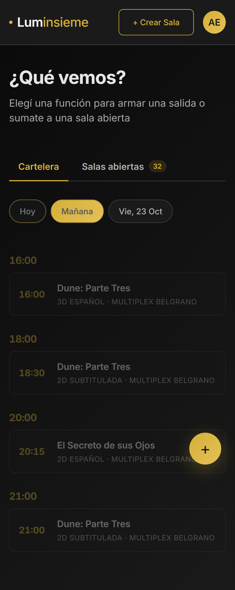
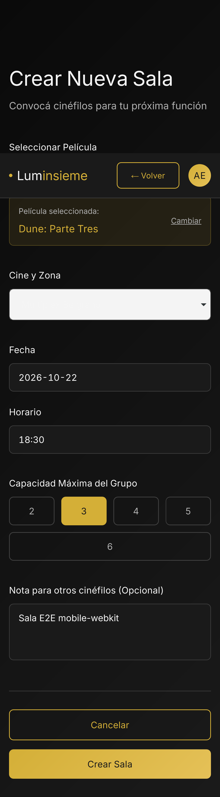
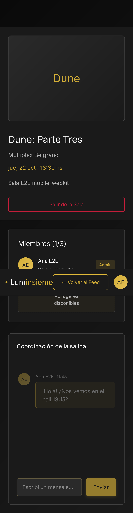
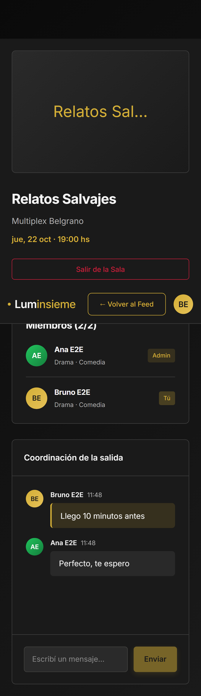

# Resultados de la ejecución del Plan de Pruebas — LumInsieme (TP4)

| | |
|---|---|
| **Fecha de ejecución** | 21/10/2026 (zona horaria America/Argentina/Buenos_Aires) |
| **Rama / código probado** | `tp4-plan-pruebas`, a partir de `655f973` + correcciones `9727b91`, `0ee56db`, `9347ad4`, `f5f74d3` |
| **Alcance** | CU-01 a CU-06 y pruebas transversales (scrapper, cache-controller, E2E, carga y seguridad) |
| **Herramientas** | Vitest + RTL, Vitest + Supertest, pytest, go test + Testify + miniredis, Playwright, k6, OWASP ZAP baseline |

## 1. Resumen

- **198 pruebas** con ID trazable y **206 ejecuciones** (las 8 pruebas E2E corren en Chromium y en WebKit). En la corrida final pasaron **198 de 198**.
- En la primera corrida fallaron **5 pruebas** que destaparon **4 defectos** del producto. Los 4 están registrados y corregidos, cada uno en su propio commit, en [defectos.md](defectos.md).
- RNF de rendimiento: GET /cartelera y GET /salas dan **p95 de 6,0 y 10,0 ms con 50 usuarios virtuales** y de **107 y 111 ms con 200**, contra un objetivo de 200 ms. El chat entrega los mensajes con **p95 de 3 ms con 60 usuarios conectados**. Error 0 % en todos los escenarios.
- Seguridad: el baseline de ZAP **no reporta alertas High**. Tras corregir DEF-04 las alertas Medium bajan de 3 a 1 y las Low de 8 a 1; las dos que quedan son riesgos aceptados y están justificados.
- Hay 6 observaciones que no son defectos (OBS-01 a OBS-06, en [defectos.md](defectos.md#observaciones-no-son-defectos)).

## 2. Entorno

### 2.1. Equipo y plataforma

| Elemento | Versión |
|---|---|
| Sistema operativo | Microsoft Windows 11 Home 10.0.26200, 64 bits |
| Hardware | Intel Core i7-8750H @ 2,20 GHz (12 hilos), 15,9 GB RAM |
| Docker | Docker Desktop, motor 29.6.2, Compose 5.3.1 (8 GB asignados a la VM) |
| Node.js / npm | 22.13.1 / 11.3.0 |
| Python | 3.13.3 (venv local para pytest). La imagen del scrapper usa 3.11 |
| Go | 1.25.14 (contenedor `golang:1.25`, el mismo toolchain que usa el Dockerfile del servicio) |
| PostgreSQL / Redis | 16.14 (`postgres:16-alpine`) / 7.4.11 (`redis:7-alpine`) |

### 2.2. Herramientas de prueba

| Herramienta | Versión | Uso |
|---|---|---|
| Vitest + @vitest/coverage-v8 | 5.0.5 | login, reunion, chat y frontend |
| Supertest | 7.3.1 | API HTTP de login, reunion y chat |
| React Testing Library / user-event / jsdom | 16.3.3 / 14.6.8 / 26.1.0 | componentes y páginas del frontend |
| pytest / pytest-asyncio / pytest-cov | 8.4.2 / 1.2.0 / 7.0.0 | scrapper (Playwright para Python 1.60.0, grpcio 1.83.1) |
| go test + Testify + miniredis | Testify 1.12.1, miniredis 2.40.0 | cache-controller (go-redis 9.22.0) |
| Playwright Test | 1.64.1 (Chromium 156.0.8078.4, WebKit 27.2) | E2E en viewport mobile: Pixel 7 (Chromium) e iPhone 14 (WebKit) |
| k6 | 1.3.0 (`grafana/k6:1.3.0`) | carga y estrés |
| OWASP ZAP | 2.17.0 (`ghcr.io/zaproxy/zaproxy:stable`, `zap-baseline.py`) | seguridad |
| Postman/Newman | — | No se usó (era opcional); la API se cubre con Supertest |

### 2.3. Stack de pruebas

- Las pruebas de integración, E2E, carga y seguridad corren contra un **stack Docker aislado** ([`tests/stack/docker-compose.test.yml`](../../tests/stack/docker-compose.test.yml), proyecto `luminsieme-test`). Se construye con los mismos Dockerfiles que producción, guarda los datos en `tmpfs` y genera secretos al azar en cada instalación (`tests/stack/test.env`, ignorado por git). **No toca los volúmenes de desarrollo.**
- Las suites de Vitest de login y reunion crean su propia base descartable (`luminsieme_test_login` y `luminsieme_test_reunion`) en el Postgres del stack, puerto 55432.
- Datos sembrados con `node tests/stack/stack.mjs seed`: 62 usuarios, 32 salas (12 con 5 miembros, para el chat bajo carga) y una cartelera de 3 días en el formato actual del scrapper. La cartelera incluye una función de hoy a las 00:01, para comprobar que las funciones ya iniciadas aparecen deshabilitadas.
- **Login en E2E:** el login real con Google no se automatiza. Se inyecta la cookie `lum_session` con un JWT firmado con el secreto del stack, con los mismos claims, emisor y audiencia que emite login-controller. El flujo OAuth (state, callback, errores) se cubre en integración, simulando el token endpoint (PT-CU01-10 a PT-CU01-15).
- **Destino de k6 y ZAP:** el frontend nginx en `https://localhost:8443`. Como k6 y ZAP corren en contenedores, desde ellos esa dirección se alcanza como `https://host.docker.internal:8443`, que es el mismo puerto publicado por Docker Desktop.

### 2.4. Convención de IDs

`PT-CU0X-NN` identifica una prueba de un caso de uso y `PT-TR-NN` una prueba transversal. Las transversales usan rangos por área: 01–09 salud de servicios y utilidades, 10–29 scrapper, 30–49 cache-controller, 50–59 E2E, 60–69 carga, 70–79 seguridad. El ID va al principio del título de cada prueba, así que es lo que muestran todos los reportes. La tabla de la sección 9 la genera [`tests/report/collect.mjs`](../../tests/report/collect.mjs) a partir de los resultados crudos de [`reportes/raw/`](reportes/raw/).

## 3. Totales por herramienta

| Herramienta | Niveles | Pruebas | Ejecuciones | Pasaron | Fallaron (corrida final) | Fallaron en la 1.ª corrida |
|---|---|---:|---:|---:|---:|---|
| Vitest + Supertest | Unitaria, integración API/WebSocket/gRPC | 112 | 112 | 112 | 0 | 1 (PT-CU05-20 → DEF-01) |
| Vitest + RTL | Unitaria de componente, integración UI | 34 | 34 | 34 | 0 | 0 por defectos del producto (2 errores de la propia prueba, corregidos) |
| pytest | Unitaria, integración con Chromium y gRPC | 19 | 19 | 19 | 0 | 1 (PT-TR-24 → DEF-03) |
| go test + Testify + miniredis | Unitaria, integración gRPC | 17 | 17 | 17 | 0 | 1 (PT-TR-35 → DEF-02) |
| Playwright | E2E (Chromium + WebKit mobile) | 8 | 16 | 16 | 0 | 0 |
| k6 | Carga, estrés | 5 | 5 | 5 | 0 | 0 (con OBS-01 en PT-TR-63) |
| OWASP ZAP baseline | Seguridad | 3 | 3 | 3 | 0 | 2 (PT-TR-71 y PT-TR-72 → DEF-04) |
| **Total** | | **198** | **206** | **206** | **0** | **5 pruebas, 4 defectos** |

Distribución por caso de uso:

| CU-01 Autenticación | CU-02 Creación de sala | CU-03 Feed y cartelera | CU-04 Incorporación | CU-05 Coordinación (chat) | CU-06 Abandono | Transversales |
|---:|---:|---:|---:|---:|---:|---:|
| 40 | 21 | 30 | 12 | 28 | 8 | 59 |

## 4. Cobertura por módulo

| Módulo | Herramienta | Sentencias | Ramas | Funciones | Líneas | Reporte |
|---|---|---:|---:|---:|---:|---|
| login-controller | Vitest (v8) | 88,8 % (207/233) | 83,6 % (127/152) | 94,6 % (35/37) | 91,0 % (191/210) | [HTML](reportes/cobertura/login-controller/index.html) |
| reunion-controller | Vitest (v8) | 81,3 % (295/363) | 75,0 % (147/196) | 79,5 % (58/73) | 83,7 % (262/313) | [HTML](reportes/cobertura/reunion-controller/index.html) |
| chat-controller | Vitest (v8) | 87,9 % (145/165) | 72,6 % (45/62) | 94,3 % (33/35) | 90,3 % (140/155) | [HTML](reportes/cobertura/chat-controller/index.html) |
| frontend | Vitest (v8) | 76,6 % (441/576) | 67,2 % (238/354) | 68,0 % (119/175) | 79,5 % (396/498) | [HTML](reportes/cobertura/frontend/index.html) |
| cache-controller | go test -cover | 68,0 % del paquete (`server.go`: 85,1 %, 80/94) | n/d | — | — | [HTML](reportes/cobertura/cache-controller/index.html) |
| scrapper | pytest-cov | 84 % (195/231) | n/d | — | 84 % | [HTML](reportes/cobertura/scrapper/index.html) |

Cómo leer estos números:

- **reunion-controller:** controladores 96,9 %, repositorios 100 %, servicio de cartelera 96,3 % y modelos 94,5 %. Bajan el total `config.js`, `database.js` y `migrations.js` (45 % en `src/`), porque el esquema se aplica en el `globalSetup` fuera de la instrumentación, y `clients/cacheClient.js` (27,8 %), que en estas pruebas se reemplaza por un doble. El cliente gRPC real se ejercita en E2E y en k6.
- **frontend:** utilidades 96,3 %, contexto 83 %, componentes 79,7 % y hook del chat 79,1 %. Las páginas quedan en 66,5 %, porque Perfil y Editar perfil no tienen pruebas propias (no forman parte de los CU priorizados).
- **cache-controller:** el 68 % incluye `main()` (arranque del proceso y señales), que no se prueba. La lógica del servicio, `server.go`, llega al 85,1 %. Lo que falta son los `return` de error de Redis en operaciones auxiliares (Set, Delete, Hash, Publish).
- **scrapper:** se excluyen los stubs gRPC generados (`pb/`) y las propias pruebas. `grpc_client.py` 100 %, `main.py` 97 %, `browserController.py` 85 %, `multiplexScrapping.py` 78 %. `cinepolisStrategy.py` está en 0 % porque todavía es un stub sin implementar.
- Go y coverage.py en modo líneas no miden ramas (n/d).

## 5. Resumen de k6 (carga y rendimiento)

Todos los escenarios atacan nginx por HTTPS (`https://localhost:8443`), con k6 corriendo en la misma máquina que el stack. Por eso los valores absolutos son indicativos: k6 y los servicios comparten CPU.

| ID | Escenario | Usuarios virtuales | Duración | Peticiones / mensajes | p95 | p99 | Tasa de error | Umbral | Resultado |
|---|---|---:|---|---|---:|---:|---:|---|---|
| PT-TR-60 | GET /cartelera | rampa 0→50→0 | 1 min 45 s | 4085 (77 req/s en total con /salas) | 5,96 ms | 8,82 ms | 0,00 % | p95 < 200 ms, error < 1 % | ✅ |
| PT-TR-61 | GET /salas (con sesión) | rampa 0→50→0 | 1 min 45 s | 4085 | 10,00 ms | 13,50 ms | 0,00 % | p95 < 200 ms, error < 1 % | ✅ |
| PT-TR-62 | Estrés: /cartelera + /salas | rampa 0→200→0 | 1 min 45 s | 30 904 (293 req/s) | 107,4 / 111,1 ms | 151,2 / 156,0 ms | 0,00 % | p95 < 200 ms, error < 1 % | ✅ |
| PT-TR-63 | Chat WebSocket (12 salas × 5 miembros, 1 msg/2 s) | 60 | 45 s por sesión | 1320 enviados / 6600 recibidos | entrega 3 ms | entrega 4 ms | 0,00 % WS | entrega p95 < 200 ms, history 100 %, 0 errores | ✅ con OBS-01 |
| PT-TR-64 | Ráfagas de ticket de chat (5 × 60 simultáneos) | 60 | 8 s | 300 | 184 / 100 / 92 / 102 / 100 ms | 187 ms (peor ráfaga) | 0,00 % | p95 < 200 ms por ráfaga | ✅ |

Detalle del chat (PT-TR-63):

- La latencia de entrega se mide desde que un usuario envía hasta que su propio mensaje vuelve por broadcast: promedio 2,4 ms, p95 3 ms y máximo 7 ms.
- Conexión del WebSocket (`ws_connecting`): p95 62 ms.
- Llegaron las 6600 entregas esperadas (1320 mensajes × 5 miembros), sin pérdidas, y el 100 % de las conexiones recibió el historial al conectar.
- Un umbral auxiliar sobre `POST /chat-ticket` sí se superó: p95 de 256 ms, porque los 60 usuarios pidieron el ticket en el mismo instante y con el servicio en frío. Para medirlo por separado se agregó PT-TR-64: desde la segunda ráfaga el p95 se estabiliza en ~100 ms. El análisis está en OBS-01.

Reportes: [`k6-http-report.html`](reportes/k6/k6-http-report.html), [`k6-http-stress-report.html`](reportes/k6/k6-http-stress-report.html), [`k6-chat-ws-report.html`](reportes/k6/k6-chat-ws-report.html) (dashboard web de k6). Resúmenes en JSON en [`reportes/k6/`](reportes/k6/).

## 6. Resumen de OWASP ZAP (baseline)

Spider tradicional + AJAX spider (2 min) contra `https://localhost:8443`, con la cookie de sesión de un usuario de prueba para alcanzar también `/auth/me`, `/salas` y `/cartelera`. La tabla cuenta tipos de alerta (como los agrupa el reporte de ZAP), no instancias.

| Riesgo | Antes de DEF-04 | Después de DEF-04 | Alertas después de la corrección |
|---|---:|---:|---|
| High | 0 | **0** | — |
| Medium | 3 | **1** | Sub Resource Integrity Attribute Missing (90003): hoja de Google Fonts. Riesgo aceptado |
| Low | 8 | **1** | Cross-Origin-Embedder-Policy (90004). Riesgo aceptado: `require-corp` bloquearía Google Fonts |
| Informational | 5 | 6 | Ticket en la URL del WebSocket (10024, ver OBS-02), "Suspicious Comments" (10027, falso positivo: el texto "Admin" del bundle), Modern Web Application (10109), Re-examine Cache-control (10015), Storable/Non-Storable Content (10049: el `no-store` nuevo aparece como informativa) |
| **Reglas PASS** | 53 | **60** | |

Antes de la corrección había alertas Medium por CSP ausente (10038) y por falta de anti-clickjacking (10020), y alertas Low por falta de HSTS (10035), X-Content-Type-Options (10021), Permissions-Policy (10063), COOP/CORP (90004) y por versión expuesta en `Server` (10036) y `X-Powered-By` (10037). Todas desaparecen tras DEF-04.

> HSTS: la corrección lo envía para cualquier host salvo `localhost`. El escaneo usó `host.docker.internal` y por eso lo detectó presente; si se navega en `https://localhost:8443` no se envía, a propósito, para no forzar HTTPS en el servidor de desarrollo de Vite (`http://localhost:5173`).

Reportes: [antes](reportes/zap/antes-zap-baseline.html) · [después](reportes/zap/zap-baseline.html). En los reportes se reemplazaron los JWT de prueba por `<jwt-redactado>`.

## 7. Defectos encontrados

| ID | Componente | Prueba | Qué falló | Commit |
|---|---|---|---|---|
| DEF-01 | chat-controller | PT-CU05-20 | Si fallaba un PushBatch, los mensajes no se reintentaban hasta que alguien volviera a escribir en la sala | `9727b91` |
| DEF-02 | cache-controller | PT-TR-35 | `GetTTL` devolvía 0 en vez de -1/-2 para claves sin vencimiento o inexistentes | `0ee56db` |
| DEF-03 | scrapper | PT-TR-24 | Si Chromium no arrancaba, `close()` lanzaba `AttributeError`, que tapaba el error real y dejaba abierto el canal gRPC | `9347ad4` |
| DEF-04 | frontend (nginx) | PT-TR-71, PT-TR-72 | Faltaban cabeceras de seguridad (CSP, anti-clickjacking, HSTS, etc.) y se exponían las versiones del servidor | `f5f74d3` |

El detalle de cada uno (qué falló, causa, corrección, commit y la salida de la prueba antes y después) está en [defectos.md](defectos.md).

## 8. Evidencias

**Reportes HTML**

- Playwright: [`reportes/playwright/index.html`](reportes/playwright/index.html). Para verlo con capturas y adjuntos: `npx playwright show-report docs/testing/reportes/playwright`.
- Cobertura: [`reportes/cobertura/`](reportes/cobertura/), un HTML por módulo.
- k6: [`reportes/k6/`](reportes/k6/).
- ZAP: [`reportes/zap/`](reportes/zap/).
- pytest: [`reportes/pytest-scrapper.html`](reportes/pytest-scrapper.html).

**Capturas E2E** (en [`capturas/`](capturas/), una serie por navegador)

| Cartelera de mañana (Chromium, Pixel 7) | Crear sala precargada (WebKit, iPhone 14) | Sala con chat (WebKit) | Chat entre dos usuarios (Chromium) |
|---|---|---|---|
|  |  |  |  |

**Salida antes y después de cada defecto:** [`evidencias/`](evidencias/).

## 9. Tabla de resultados

Nivel: *Unitaria* aísla una unidad con dobles de prueba; *Integración* usa dependencias reales o servidores simulados en proceso (Postgres del stack, WebSocket real, gRPC en memoria, Chromium real con fixture HTML); *E2E* recorre la app completa en el navegador; *Carga/Estrés/Seguridad* atacan el stack desplegado.

| ID | CU | Nivel | Herramienta | Descripción | Resultado esperado | Resultado obtenido | Estado |
|---|---|---|---|---|---|---|---|
| PT-CU01-01 | CU-01 | Integración (API + Postgres) | Vitest + Supertest | GET /auth/me sin cookie | 401 unauthenticated | Igual al esperado | ✅ Pasó |
| PT-CU01-02 | CU-01 | Integración (API + Postgres) | Vitest + Supertest | GET /auth/me con JWT válido en cookie | 200 con el perfil (sin googleSub) | Igual al esperado | ✅ Pasó |
| PT-CU01-03 | CU-01 | Integración (API + Postgres) | Vitest + Supertest | GET /auth/me con JWT válido por Authorization: Bearer | 200 | Igual al esperado | ✅ Pasó |
| PT-CU01-04 | CU-01 | Integración (API + Postgres) | Vitest + Supertest | GET /auth/me con JWT vencido | 401 invalid_token | Igual al esperado | ✅ Pasó |
| PT-CU01-05 | CU-01 | Integración (API + Postgres) | Vitest + Supertest | GET /auth/me con JWT firmado con otro secreto | 401 invalid_token | Igual al esperado | ✅ Pasó |
| PT-CU01-06 | CU-01 | Integración (API + Postgres) | Vitest + Supertest | GET /auth/me con JWT alg=none (sin firma) | 401 | Igual al esperado | ✅ Pasó |
| PT-CU01-07 | CU-01 | Integración (API + Postgres) | Vitest + Supertest | GET /auth/me con JWT alg=HS512 (mismo secreto) | 401 | Igual al esperado | ✅ Pasó |
| PT-CU01-08 | CU-01 | Integración (API + Postgres) | Vitest + Supertest | Ticket de chat (otro iss/aud) usado como sesión | 401 | Igual al esperado | ✅ Pasó |
| PT-CU01-09 | CU-01 | Integración (API + Postgres) | Vitest + Supertest | JWT válido de un usuario borrado | 401 y cookie expirada | Igual al esperado | ✅ Pasó |
| PT-CU01-10 | CU-01 | Integración (API + Postgres) | Vitest + Supertest | GET /auth/google | 302 a Google con state y cookie de state HttpOnly en /auth | Igual al esperado | ✅ Pasó |
| PT-CU01-11 | CU-01 | Integración (API + Postgres) | Vitest + Supertest | Callback con state distinto al de la cookie | redirect /?error=invalid_state sin sesión | Igual al esperado | ✅ Pasó |
| PT-CU01-12 | CU-01 | Integración (API + Postgres) | Vitest + Supertest | Callback sin cookie de state | redirect /?error=invalid_state | Igual al esperado | ✅ Pasó |
| PT-CU01-13 | CU-01 | Integración (API + Postgres) | Vitest + Supertest | Callback con error de Google (usuario cancela) | redirect /?error=access_denied | Igual al esperado | ✅ Pasó |
| PT-CU01-14 | CU-01 | Integración (API + Postgres) | Vitest + Supertest | Callback válido (token endpoint simulado) | usuario creado, cookie de sesión y redirect /feed | Igual al esperado | ✅ Pasó |
| PT-CU01-15 | CU-01 | Integración (API + Postgres) | Vitest + Supertest | Callback con fallo del token endpoint | redirect /?error=oauth_failed | Igual al esperado | ✅ Pasó |
| PT-CU01-16 | CU-01 | Integración (API + Postgres) | Vitest + Supertest | PATCH /auth/me con edad menor a 13 | 400 invalid_profile | Igual al esperado | ✅ Pasó |
| PT-CU01-17 | CU-01 | Integración (API + Postgres) | Vitest + Supertest | PATCH /auth/me con edad mayor a 120 | 400 invalid_profile | Igual al esperado | ✅ Pasó |
| PT-CU01-18 | CU-01 | Integración (API + Postgres) | Vitest + Supertest | PATCH /auth/me con edad como texto | 400 invalid_profile | Igual al esperado | ✅ Pasó |
| PT-CU01-19 | CU-01 | Integración (API + Postgres) | Vitest + Supertest | PATCH /auth/me con géneros fuera de la lista blanca | 400 invalid_profile | Igual al esperado | ✅ Pasó |
| PT-CU01-20 | CU-01 | Integración (API + Postgres) | Vitest + Supertest | PATCH /auth/me con 6 películas favoritas | 400 invalid_profile | Igual al esperado | ✅ Pasó |
| PT-CU01-21 | CU-01 | Integración (API + Postgres) | Vitest + Supertest | PATCH /auth/me sin campos editables | 400 | Igual al esperado | ✅ Pasó |
| PT-CU01-22 | CU-01 | Integración (API + Postgres) | Vitest + Supertest | PATCH /auth/me válido | 200, perfil persistido y géneros deduplicados | Igual al esperado | ✅ Pasó |
| PT-CU01-23 | CU-01 | Integración (API + Postgres) | Vitest + Supertest | PATCH /auth/me sin sesión | 401 | Igual al esperado | ✅ Pasó |
| PT-CU01-24 | CU-01 | Integración (API + Postgres) | Vitest + Supertest | POST /auth/logout | 204 y cookie lum_session expirada | Igual al esperado | ✅ Pasó |
| PT-CU01-25 | CU-01 | Integración (API + Postgres) | Vitest + Supertest | DELETE /auth/me | 204 y usuario eliminado | Igual al esperado | ✅ Pasó |
| PT-CU01-26 | CU-01 | Integración (API + Postgres) | Vitest + Supertest | GET /health con la base disponible | 200 {status: ok, db: ok} | Igual al esperado | ✅ Pasó |
| PT-CU01-27 | CU-01 | Unitaria | Vitest + Supertest | decodeIdToken con id_token válido | perfil normalizado | Igual al esperado | ✅ Pasó |
| PT-CU01-28 | CU-01 | Unitaria | Vitest + Supertest | decodeIdToken con emisor ajeno | error | Igual al esperado | ✅ Pasó |
| PT-CU01-29 | CU-01 | Unitaria | Vitest + Supertest | decodeIdToken con audiencia de otro cliente | error | Igual al esperado | ✅ Pasó |
| PT-CU01-30 | CU-01 | Unitaria | Vitest + Supertest | decodeIdToken con vencido | error | Igual al esperado | ✅ Pasó |
| PT-CU01-31 | CU-01 | Unitaria | Vitest + Supertest | decodeIdToken con email no verificado | error | Igual al esperado | ✅ Pasó |
| PT-CU01-32 | CU-01 | Unitaria | Vitest + Supertest | decodeIdToken con token mal formado | error de formato | Igual al esperado | ✅ Pasó |
| PT-CU01-33 | CU-01 | Unitaria | Vitest + Supertest | buildAuthUrl | scope openid email profile, response_type code y state propagado | Igual al esperado | ✅ Pasó |
| PT-CU01-34 | CU-01 | Unitaria | Vitest + Supertest | sanitizeProfile con edad null, 14 géneros válidos y 5 películas | sin errores | Igual al esperado | ✅ Pasó |
| PT-CU01-35 | CU-01 | Unitaria | Vitest + Supertest | sanitizeProfile con arreglo, película sin título, nombre >80 o ciudad no texto | errores | Igual al esperado | ✅ Pasó |
| PT-CU01-36 | CU-01 | Integración (UI + API simulada) | Vitest + RTL | Sin sesión (/auth/me 401) una ruta interna | redirige al login | Igual al esperado | ✅ Pasó |
| PT-CU01-37 | CU-01 | Integración (UI + API simulada) | Vitest + RTL | Login con ?error=invalid_state | muestra 'La sesión de inicio expiró' | Igual al esperado | ✅ Pasó |
| PT-CU01-38 | CU-01 | Integración (UI + API simulada) | Vitest + RTL | Con sesión válida el login | redirige al feed | Igual al esperado | ✅ Pasó |
| PT-CU01-39 | CU-01 | Integración (UI + API simulada) | Vitest + RTL | Cerrar sesión desde el perfil | POST /auth/logout y vuelta al login | Igual al esperado | ✅ Pasó |
| PT-CU01-40 | CU-01 | Integración (UI + API simulada) | Vitest + RTL | Un 401 de /salas (JWT vencido) | la app cierra la sesión y vuelve al login | Igual al esperado | ✅ Pasó |
| PT-CU02-01 | CU-02 | Integración (API + Postgres) | Vitest + Supertest | POST /salas con cupo 1 | 400 invalid_sala | Igual al esperado | ✅ Pasó |
| PT-CU02-02 | CU-02 | Integración (API + Postgres) | Vitest + Supertest | POST /salas con cupo 7 | 400 invalid_sala | Igual al esperado | ✅ Pasó |
| PT-CU02-03 | CU-02 | Integración (API + Postgres) | Vitest + Supertest | POST /salas con cupo no entero (3.5) | 400 invalid_sala | Igual al esperado | ✅ Pasó |
| PT-CU02-04 | CU-02 | Integración (API + Postgres) | Vitest + Supertest | POST /salas con fecha pasada (ayer) | 400 invalid_sala | Igual al esperado | ✅ Pasó |
| PT-CU02-05 | CU-02 | Integración (API + Postgres) | Vitest + Supertest | POST /salas con fecha inexistente (2026-02-30) | 400 invalid_sala | Igual al esperado | ✅ Pasó |
| PT-CU02-06 | CU-02 | Integración (API + Postgres) | Vitest + Supertest | POST /salas con hora inválida (25:00) | 400 invalid_sala | Igual al esperado | ✅ Pasó |
| PT-CU02-07 | CU-02 | Integración (API + Postgres) | Vitest + Supertest | POST /salas con hora sin formato HH:MM (8:5) | 400 invalid_sala | Igual al esperado | ✅ Pasó |
| PT-CU02-08 | CU-02 | Integración (API + Postgres) | Vitest + Supertest | POST /salas con película de 121 caracteres | 400 invalid_sala | Igual al esperado | ✅ Pasó |
| PT-CU02-09 | CU-02 | Integración (API + Postgres) | Vitest + Supertest | POST /salas con cine de 121 caracteres | 400 invalid_sala | Igual al esperado | ✅ Pasó |
| PT-CU02-10 | CU-02 | Integración (API + Postgres) | Vitest + Supertest | POST /salas con nota de 501 caracteres | 400 invalid_sala | Igual al esperado | ✅ Pasó |
| PT-CU02-11 | CU-02 | Integración (API + Postgres) | Vitest + Supertest | POST /salas con película vacía | 400 invalid_sala | Igual al esperado | ✅ Pasó |
| PT-CU02-12 | CU-02 | Integración (API + Postgres) | Vitest + Supertest | POST /salas con un arreglo como cuerpo | 400 invalid_sala | Igual al esperado | ✅ Pasó |
| PT-CU02-13 | CU-02 | Integración (API + Postgres) | Vitest + Supertest | POST /salas sin sesión | 401 | Igual al esperado | ✅ Pasó |
| PT-CU02-14 | CU-02 | Integración (API + Postgres) | Vitest + Supertest | POST /salas válido | 201, el creador queda como miembro y anfitrión | Igual al esperado | ✅ Pasó |
| PT-CU02-15 | CU-02 | Integración (API + Postgres) | Vitest + Supertest | POST /salas con cupo límite 2 | 201 | Igual al esperado | ✅ Pasó |
| PT-CU02-16 | CU-02 | Integración (API + Postgres) | Vitest + Supertest | POST /salas con cupo límite 6 | 201 | Igual al esperado | ✅ Pasó |
| PT-CU02-17 | CU-02 | Integración (API + Postgres) | Vitest + Supertest | POST /salas con fecha de hoy | 201 | Igual al esperado | ✅ Pasó |
| PT-CU02-18 | CU-02 | Integración (API + Postgres) | Vitest + Supertest | La sala no expone email de los miembros | solo id, name, genres, isAdmin | Igual al esperado | ✅ Pasó |
| PT-CU02-19 | CU-02 | Integración (UI + API simulada) | Vitest + RTL | Enviar el formulario con cine, fecha y hora pero sin película | 'Elegí una película para la sala.' sin llamar a la API | Igual al esperado | ✅ Pasó |
| PT-CU02-20 | CU-02 | Integración (UI + API simulada) | Vitest + RTL | Rechazo del backend (400 invalid_sala) | muestra los detalles de validación | Igual al esperado | ✅ Pasó |
| PT-CU02-21 | CU-02 | Integración (UI + API simulada) | Vitest + RTL | Formulario precargado desde la cartelera | POST /salas con los datos y navega a la sala | Igual al esperado | ✅ Pasó |
| PT-CU03-01 | CU-03 | Integración (API + Postgres) | Vitest + Supertest | GET /salas sin sesión | 401 unauthenticated | Igual al esperado | ✅ Pasó |
| PT-CU03-02 | CU-03 | Integración (API + Postgres) | Vitest + Supertest | GET /salas con JWT inválido | 401 invalid_token | Igual al esperado | ✅ Pasó |
| PT-CU03-03 | CU-03 | Integración (API + Postgres) | Vitest + Supertest | GET /salas | ordenado por created_at DESC (no por fecha de la función) | Igual al esperado | ✅ Pasó |
| PT-CU03-04 | CU-03 | Integración (API + Postgres) | Vitest + Supertest | GET /salas | oculta salas vencidas (fecha anterior a hoy) y muestra las de hoy | Igual al esperado | ✅ Pasó |
| PT-CU03-05 | CU-03 | Integración (API + Postgres) | Vitest + Supertest | GET /salas/:id con id mal formado | 404 sala_not_found | Igual al esperado | ✅ Pasó |
| PT-CU03-06 | CU-03 | Integración (API + Postgres) | Vitest + Supertest | GET /salas/:id inexistente | 404 sala_not_found | Igual al esperado | ✅ Pasó |
| PT-CU03-07 | CU-03 | Integración (API + Postgres) | Vitest + Supertest | GET /salas/:id existente | 200 con miembros | Igual al esperado | ✅ Pasó |
| PT-CU03-08 | CU-03 | Integración (API, caché simulada) | Vitest + Supertest | Formato actual del scrapper (días 'AAAA-M-D' sin ceros) | fechas normalizadas AAAA-MM-DD | Igual al esperado | ✅ Pasó |
| PT-CU03-09 | CU-03 | Integración (API, caché simulada) | Vitest + Supertest | Formato anterior del scrapper (lista plana con fecha ISO) | mismo resultado normalizado | Igual al esperado | ✅ Pasó |
| PT-CU03-10 | CU-03 | Integración (API, caché simulada) | Vitest + Supertest | Ambos formatos mezclados y una función repetida | cada función se lista una sola vez | Igual al esperado | ✅ Pasó |
| PT-CU03-11 | CU-03 | Integración (API, caché simulada) | Vitest + Supertest | Funciones ordenadas por hora, luego título y formato | — | Igual al esperado | ✅ Pasó |
| PT-CU03-12 | CU-03 | Integración (API, caché simulada) | Vitest + Supertest | Sin datos en caché (clave inexistente) | 200 con dates: [] y screenings: [] | Igual al esperado | ✅ Pasó |
| PT-CU03-13 | CU-03 | Integración (API, caché simulada) | Vitest + Supertest | Caché caída (gRPC UNAVAILABLE) | 503 cache_unavailable | Igual al esperado | ✅ Pasó |
| PT-CU03-14 | CU-03 | Integración (API, caché simulada) | Vitest + Supertest | scraped_data con JSON corrupto | 200 con dates: [] | Igual al esperado | ✅ Pasó |
| PT-CU03-15 | CU-03 | Integración (API, caché simulada) | Vitest + Supertest | Sin ?fecha | elige hoy o el próximo día con funciones (ignora días pasados) | Igual al esperado | ✅ Pasó |
| PT-CU03-16 | CU-03 | Integración (API, caché simulada) | Vitest + Supertest | ?fecha con formato inválido | 400 invalid_date | Igual al esperado | ✅ Pasó |
| PT-CU03-17 | CU-03 | Integración (API, caché simulada) | Vitest + Supertest | Películas sin título u horarios inválidos | se descartan | Igual al esperado | ✅ Pasó |
| PT-CU03-18 | CU-03 | Integración (API, caché simulada) | Vitest + Supertest | GET /cartelera/peliculas | catálogo plano normalizado | Igual al esperado | ✅ Pasó |
| PT-CU03-19 | CU-03 | Unitaria (componente) | Vitest + RTL | DaySelector sin fechas | no renderiza nada | Igual al esperado | ✅ Pasó |
| PT-CU03-20 | CU-03 | Unitaria (componente) | Vitest + RTL | DaySelector | chips 'Hoy', 'Mañana' y fecha corta para el resto | Igual al esperado | ✅ Pasó |
| PT-CU03-21 | CU-03 | Unitaria (componente) | Vitest + RTL | DaySelector | solo el día elegido tiene aria-selected=true | Igual al esperado | ✅ Pasó |
| PT-CU03-22 | CU-03 | Unitaria (componente) | Vitest + RTL | DaySelector al tocar un día | onSelect con la fecha AAAA-MM-DD | Igual al esperado | ✅ Pasó |
| PT-CU03-23 | CU-03 | Unitaria (componente) | Vitest + RTL | ScreeningTimeline de hoy | funciones ya iniciadas deshabilitadas con 'Empezó' | Igual al esperado | ✅ Pasó |
| PT-CU03-24 | CU-03 | Unitaria (componente) | Vitest + RTL | ScreeningTimeline de otro día | ninguna función deshabilitada | Igual al esperado | ✅ Pasó |
| PT-CU03-25 | CU-03 | Unitaria (componente) | Vitest + RTL | ScreeningTimeline | agrupa por franja horaria (HH:00) respetando el orden | Igual al esperado | ✅ Pasó |
| PT-CU03-26 | CU-03 | Unitaria (componente) | Vitest + RTL | Elegir una función futura | navega a /crear-sala con película, cine, fecha y hora precargados | Igual al esperado | ✅ Pasó |
| PT-CU03-27 | CU-03 | Integración (UI + API simulada) | Vitest + RTL | Cartelera sin datos (dates: []) | 'La cartelera todavía no está disponible' | Igual al esperado | ✅ Pasó |
| PT-CU03-28 | CU-03 | Integración (UI + API simulada) | Vitest + RTL | Cartelera con caché caída (503) | mensaje de error visible | Igual al esperado | ✅ Pasó |
| PT-CU03-29 | CU-03 | Integración (UI + API simulada) | Vitest + RTL | Pestaña 'Salas abiertas' | lista las salas en el orden recibido con contador | Igual al esperado | ✅ Pasó |
| PT-CU03-30 | CU-03 | Integración (UI + API simulada) | Vitest + RTL | Elegir un día del selector | pide /cartelera?fecha=AAAA-MM-DD | Igual al esperado | ✅ Pasó |
| PT-CU04-01 | CU-04 | Integración (API + Postgres) | Vitest + Supertest | POST /salas/:id/miembros | 200 y el usuario figura como miembro | Igual al esperado | ✅ Pasó |
| PT-CU04-02 | CU-04 | Integración (API + Postgres) | Vitest + Supertest | Unirse dos veces a la misma sala | 200 ambas, una sola membresía (idempotente) | Igual al esperado | ✅ Pasó |
| PT-CU04-03 | CU-04 | Integración (API + Postgres) | Vitest + Supertest | Unirse a una sala completa | 409 sala_full | Igual al esperado | ✅ Pasó |
| PT-CU04-04 | CU-04 | Integración (API + Postgres) | Vitest + Supertest | Un miembro de una sala completa vuelve a unirse | 200 (no 409) | Igual al esperado | ✅ Pasó |
| PT-CU04-05 | CU-04 | Integración (API + Postgres) | Vitest + Supertest | Unirse a una sala vencida | 409 sala_closed | Igual al esperado | ✅ Pasó |
| PT-CU04-06 | CU-04 | Integración (API + Postgres) | Vitest + Supertest | Unirse a una sala inexistente | 404 sala_not_found | Igual al esperado | ✅ Pasó |
| PT-CU04-07 | CU-04 | Integración (API + Postgres) | Vitest + Supertest | Dos altas concurrentes por el último lugar (20 repeticiones) | una 200 y una 409 sala_full | Igual al esperado | ✅ Pasó |
| PT-CU04-08 | CU-04 | Integración (API + Postgres) | Vitest + Supertest | Ocho altas concurrentes en una sala de cupo 6 | 5 aceptadas, 3 rechazadas, nunca sobrecupo | Igual al esperado | ✅ Pasó |
| PT-CU04-09 | CU-04 | Integración (UI + API simulada) | Vitest + RTL | 'Unirme a la Sala' | POST miembros y pasa a mostrar 'Salir de la Sala' | Igual al esperado | ✅ Pasó |
| PT-CU04-10 | CU-04 | Integración (UI + API simulada) | Vitest + RTL | Unirse a una sala que se llenó (409 sala_full) | 'La sala está completa.' | Igual al esperado | ✅ Pasó |
| PT-CU04-11 | CU-04 | Integración (UI + API simulada) | Vitest + RTL | Sala con cupo lleno | botón deshabilitado 'Sala completa' | Igual al esperado | ✅ Pasó |
| PT-CU04-12 | CU-04 | Unitaria (componente) | Vitest + RTL | joinSala con 409 sala_closed | error con mensaje 'La función de esta sala ya pasó.' y status 409 | Igual al esperado | ✅ Pasó |
| PT-CU05-01 | CU-05 | Integración (API + Postgres) | Vitest + Supertest | POST /salas/:id/chat-ticket de un no miembro | 403 not_a_member | Igual al esperado | ✅ Pasó |
| PT-CU05-02 | CU-05 | Integración (API + Postgres) | Vitest + Supertest | POST /salas/:id/chat-ticket de un miembro | 200 con ticket (aud luminsieme-chat, 5 min) | Igual al esperado | ✅ Pasó |
| PT-CU05-03 | CU-05 | Integración (API + Postgres) | Vitest + Supertest | POST /salas/:id/chat-ticket sin sesión | 401 | Igual al esperado | ✅ Pasó |
| PT-CU05-04 | CU-05 | Integración (WebSocket) | Vitest + Supertest | WebSocket con ticket inválido | cierre 4401 'invalid ticket' | Igual al esperado | ✅ Pasó |
| PT-CU05-05 | CU-05 | Integración (WebSocket) | Vitest + Supertest | WebSocket sin ticket | cierre 4401 | Igual al esperado | ✅ Pasó |
| PT-CU05-06 | CU-05 | Integración (WebSocket) | Vitest + Supertest | WebSocket con ticket firmado con otro secreto | cierre 4401 | Igual al esperado | ✅ Pasó |
| PT-CU05-07 | CU-05 | Integración (WebSocket) | Vitest + Supertest | WebSocket con ticket vencido | cierre 4401 | Igual al esperado | ✅ Pasó |
| PT-CU05-08 | CU-05 | Integración (WebSocket) | Vitest + Supertest | WebSocket con el JWT de sesión (aud luminsieme) en lugar del ticket | cierre 4401 | Igual al esperado | ✅ Pasó |
| PT-CU05-09 | CU-05 | Integración (WebSocket) | Vitest + Supertest | Al conectar | frame history con los últimos 50 mensajes de chat:<sala> | Igual al esperado | ✅ Pasó |
| PT-CU05-10 | CU-05 | Integración (WebSocket) | Vitest + Supertest | Caché caída al pedir historial | sin history, pero el socket sigue abierto y difunde | Igual al esperado | ✅ Pasó |
| PT-CU05-11 | CU-05 | Integración (WebSocket) | Vitest + Supertest | Mensaje de un miembro | broadcast a todos los miembros de la sala y a nadie más | Igual al esperado | ✅ Pasó |
| PT-CU05-12 | CU-05 | Integración (WebSocket) | Vitest + Supertest | La identidad sale del ticket: userId/username enviados por el cliente se ignoran | — | Igual al esperado | ✅ Pasó |
| PT-CU05-13 | CU-05 | Integración (WebSocket) | Vitest + Supertest | Mensaje vacío o solo espacios | descartado (sin broadcast ni persistencia) | Igual al esperado | ✅ Pasó |
| PT-CU05-14 | CU-05 | Integración (WebSocket) | Vitest + Supertest | Mensajes de 1001 y de 1000 caracteres | el de 1001 se descarta y el de 1000 se difunde | Igual al esperado | ✅ Pasó |
| PT-CU05-15 | CU-05 | Integración (WebSocket) | Vitest + Supertest | Frame que no es JSON | ignorado sin cerrar la conexión | Igual al esperado | ✅ Pasó |
| PT-CU05-16 | CU-05 | Unitaria (fake timers) | Vitest + Supertest | 9 mensajes no disparan PushBatch; el 10.º envía el lote completo (chat:<sala>, TTL 3 días) | — | Igual al esperado | ✅ Pasó |
| PT-CU05-17 | CU-05 | Unitaria (fake timers) | Vitest + Supertest | 3 mensajes sin completar el lote | PushBatch a los 3 s exactos (fake timers) | Igual al esperado | ✅ Pasó |
| PT-CU05-18 | CU-05 | Unitaria (fake timers) | Vitest + Supertest | Lote completo antes de los 3 s | cancela el timer (no hay PushBatch vacío ni duplicado) | Igual al esperado | ✅ Pasó |
| PT-CU05-19 | CU-05 | Unitaria (fake timers) | Vitest + Supertest | Buffers y timers independientes por sala | — | Igual al esperado | ✅ Pasó |
| PT-CU05-20 | CU-05 | Unitaria (fake timers) | Vitest + Supertest | PushBatch falla | los mensajes vuelven al buffer y se reintentan en el próximo intervalo de 3 s | 1.ª corrida: falló (DEF-01). Tras la corrección: igual al esperado | ✅ Pasó (tras DEF-01) |
| PT-CU05-21 | CU-05 | Unitaria (fake timers) | Vitest + Supertest | flushAll (apagado) persiste todos los buffers pendientes | — | Igual al esperado | ✅ Pasó |
| PT-CU05-22 | CU-05 | Integración (gRPC simulado) | Vitest + Supertest | pushBatch + range por gRPC | los mensajes se guardan y se leen en orden | Igual al esperado | ✅ Pasó |
| PT-CU05-23 | CU-05 | Integración (gRPC simulado) | Vitest + Supertest | health por gRPC | redis_connected true | Igual al esperado | ✅ Pasó |
| PT-CU05-24 | CU-05 | Integración (UI + API simulada) | Vitest + RTL | No miembro en la sala | chat deshabilitado con 'Unite a la sala para participar del chat' | Igual al esperado | ✅ Pasó |
| PT-CU05-25 | CU-05 | Unitaria (componente) | Vitest + RTL | useSalaChat | pide ticket, abre ws(s)://host/ws/chat?ticket=… y carga el history | Igual al esperado | ✅ Pasó |
| PT-CU05-26 | CU-05 | Unitaria (componente) | Vitest + RTL | useSalaChat con ticket rechazado (403) | estado 'error' sin reintentar | Igual al esperado | ✅ Pasó |
| PT-CU05-27 | CU-05 | Unitaria (componente) | Vitest + RTL | ChatPanel | no envía mensajes vacíos y limpia el borrador tras enviar | Igual al esperado | ✅ Pasó |
| PT-CU05-28 | CU-05 | Unitaria (componente) | Vitest + RTL | ChatPanel desconectado | 'Conectando…' y botón Enviar deshabilitado | Igual al esperado | ✅ Pasó |
| PT-CU06-01 | CU-06 | Integración (API + Postgres) | Vitest + Supertest | DELETE /salas/:id/miembros/me | 200 y el usuario deja de ser miembro | Igual al esperado | ✅ Pasó |
| PT-CU06-02 | CU-06 | Integración (API + Postgres) | Vitest + Supertest | El anfitrión abandona | la sala pasa al miembro más antiguo | Igual al esperado | ✅ Pasó |
| PT-CU06-03 | CU-06 | Integración (API + Postgres) | Vitest + Supertest | El último miembro abandona | sala eliminada ({sala: null} y luego 404) | Igual al esperado | ✅ Pasó |
| PT-CU06-04 | CU-06 | Integración (API + Postgres) | Vitest + Supertest | Ticket de chat pedido después de salir | 403 not_a_member | Igual al esperado | ✅ Pasó |
| PT-CU06-05 | CU-06 | Integración (API + Postgres) | Vitest + Supertest | Abandonar una sala inexistente | 404 sala_not_found | Igual al esperado | ✅ Pasó |
| PT-CU06-06 | CU-06 | Integración (API + Postgres) | Vitest + Supertest | Tras salir, el usuario puede volver a unirse si hay lugar | 200 | Igual al esperado | ✅ Pasó |
| PT-CU06-07 | CU-06 | Integración (UI + API simulada) | Vitest + RTL | Último miembro sale (respuesta {sala: null}) | vuelve a 'Salas abiertas' | Igual al esperado | ✅ Pasó |
| PT-CU06-08 | CU-06 | Unitaria (componente) | Vitest + RTL | leaveSala cuando la sala se elimina | devuelve null | Igual al esperado | ✅ Pasó |
| PT-TR-01 | Transversal | Integración (API, caché simulada) | Vitest + Supertest | GET /health con base OK y caché caída | 200 status degraded | Igual al esperado | ✅ Pasó |
| PT-TR-02 | Transversal | Integración (API, caché simulada) | Vitest + Supertest | GET /health con base y caché OK | 200 status ok | Igual al esperado | ✅ Pasó |
| PT-TR-03 | Transversal | Integración (WebSocket) | Vitest + Supertest | GET /health con Redis conectado | {status: ok, cache: ok} | Igual al esperado | ✅ Pasó |
| PT-TR-04 | Transversal | Integración (WebSocket) | Vitest + Supertest | GET /health con el cache-controller caído | {status: degraded, cache: error} | Igual al esperado | ✅ Pasó |
| PT-TR-05 | Transversal | Unitaria (componente) | Vitest + RTL | formatDate/formatDateTime | 'mar, 14 jul · 20:30 hs' sin corrimiento de día por UTC | Igual al esperado | ✅ Pasó |
| PT-TR-06 | Transversal | Unitaria (componente) | Vitest + RTL | formatMessageTime | solo hora si es de hoy; fecha y hora si no | Igual al esperado | ✅ Pasó |
| PT-TR-07 | Transversal | Unitaria (componente) | Vitest + RTL | posterLabel y getInitials | etiquetas cortas para pósters y avatares | Igual al esperado | ✅ Pasó |
| PT-TR-10 | Transversal | Integración (Chromium + fixture HTML) | pytest | doScrapping sobre el HTML de muestra | un dict por día con las películas visibles | Igual al esperado | ✅ Pasó |
| PT-TR-11 | Transversal | Integración (Chromium + fixture HTML) | pytest | extractScreenings | excluye horarios .horario-desactivado, ocultos y formatos no visibles | Igual al esperado | ✅ Pasó |
| PT-TR-12 | Transversal | Integración (Chromium + fixture HTML) | pytest | valor de día 'M.D.AAAA' | clave 'AAAA-M-D' y MovieData con fecha, cine y duración | Igual al esperado | ✅ Pasó |
| PT-TR-13 | Transversal | Integración (Chromium + fixture HTML) | pytest | página con 6 días disponibles | se scrapean solo los primeros 5 | Igual al esperado | ✅ Pasó |
| PT-TR-14 | Transversal | Integración (Chromium + fixture HTML) | pytest | HTML sin el popup esperado (cambio de estructura del sitio) | TimeoutError en vez de datos vacíos | Igual al esperado | ✅ Pasó |
| PT-TR-15 | Transversal | Integración (Chromium + fixture HTML) | pytest | HTML con un solo complejo de cines | TimeoutError | Igual al esperado | ✅ Pasó |
| PT-TR-16 | Transversal | Integración (Chromium + fixture HTML) | pytest | PlaywrightBrowserController.start + scrapper_page + close con Chromium real | resultado de la estrategia | Igual al esperado | ✅ Pasó |
| PT-TR-17 | Transversal | Unitaria | pytest | _serialize(MovieData) | dict con fecha AAAA-MM-DD y todos los campos que lee reunion-controller | Igual al esperado | ✅ Pasó |
| PT-TR-18 | Transversal | Unitaria | pytest | [{día: [MovieData]}] (salida de gather) | JSON válido que conserva acentos y la estructura por día | Igual al esperado | ✅ Pasó |
| PT-TR-19 | Transversal | Unitaria | pytest | _serialize de str/int/None | se devuelven sin cambios | Igual al esperado | ✅ Pasó |
| PT-TR-20 | Transversal | Unitaria | pytest | repr(MovieData) | incluye título, fecha, cine y funciones | Igual al esperado | ✅ Pasó |
| PT-TR-21 | Transversal | Unitaria (mocks) | pytest | run_initial_scrape | SetWithTTL('scraped_data', JSON serializado, CACHE_TTL) una vez, por el mock del cliente gRPC | Igual al esperado | ✅ Pasó |
| PT-TR-22 | Transversal | Unitaria (mocks) | pytest | SetWithTTL responde ok=false | informa el error y termina sin excepción | Igual al esperado | ✅ Pasó |
| PT-TR-23 | Transversal | Unitaria (mocks) | pytest | La estrategia lanza una excepción | no se escribe en caché y se cierran navegador y cliente | Igual al esperado | ✅ Pasó |
| PT-TR-24 | Transversal | Unitaria (mocks) | pytest | Chromium no arranca (start falla) | se informa el error, sin excepción secundaria, y se cierra el cliente gRPC | 1.ª corrida: falló (DEF-03). Tras la corrección: igual al esperado | ✅ Pasó (tras DEF-03) |
| PT-TR-25 | Transversal | Integración (gRPC aio simulado) | pytest | CacheClient.set_with_ttl | SetWithTTLRequest con clave, valor y TTL; devuelve ok | Igual al esperado | ✅ Pasó |
| PT-TR-26 | Transversal | Integración (gRPC aio simulado) | pytest | set_json + get | serializa sin escapar acentos y get devuelve el objeto decodificado | Igual al esperado | ✅ Pasó |
| PT-TR-27 | Transversal | Integración (gRPC aio simulado) | pytest | get de clave inexistente y health | None y redis_connected=True | Igual al esperado | ✅ Pasó |
| PT-TR-28 | Transversal | Integración (gRPC aio simulado) | pytest | CacheClient sin argumentos | host y puerto desde GRPC_HOST/GRPC_PORT | Igual al esperado | ✅ Pasó |
| PT-TR-30 | Transversal | Unitaria | go test + Testify + miniredis | Get de una clave inexistente | found=false sin error | Igual al esperado | ✅ Pasó |
| PT-TR-31 | Transversal | Unitaria | go test + Testify + miniredis | Set y luego Get | devuelve el mismo valor y la clave no vence | Igual al esperado | ✅ Pasó |
| PT-TR-32 | Transversal | Unitaria | go test + Testify + miniredis | Delete y Exists | reflejan la existencia de la clave | Igual al esperado | ✅ Pasó |
| PT-TR-33 | Transversal | Unitaria | go test + Testify + miniredis | SetWithTTL (cartelera del scrapper) | la clave vence al cumplirse el TTL | Igual al esperado | ✅ Pasó |
| PT-TR-34 | Transversal | Unitaria | go test + Testify + miniredis | SetTTL sobre una clave existente y GetTTL | devuelve los segundos restantes | Igual al esperado | ✅ Pasó |
| PT-TR-35 | Transversal | Unitaria | go test + Testify + miniredis | GetTTL de clave sin vencimiento y de clave inexistente | -1 y -2 respectivamente (semántica Redis) | 1.ª corrida: falló (DEF-02). Tras la corrección: igual al esperado | ✅ Pasó (tras DEF-02) |
| PT-TR-36 | Transversal | Unitaria | go test + Testify + miniredis | PushBatch (chat) | agrega en orden, devuelve la longitud y aplica el TTL | Igual al esperado | ✅ Pasó |
| PT-TR-37 | Transversal | Unitaria | go test + Testify + miniredis | PushBatch vacío | longitud 0 y no crea la clave | Igual al esperado | ✅ Pasó |
| PT-TR-38 | Transversal | Unitaria | go test + Testify + miniredis | PushBatch con TTL 0 | no fija vencimiento | Igual al esperado | ✅ Pasó |
| PT-TR-39 | Transversal | Unitaria | go test + Testify + miniredis | Range con índices negativos (-50, -1) | últimos N mensajes en orden cronológico | Igual al esperado | ✅ Pasó |
| PT-TR-40 | Transversal | Unitaria | go test + Testify + miniredis | Range de una sala sin historial | lista vacía sin error | Igual al esperado | ✅ Pasó |
| PT-TR-41 | Transversal | Unitaria | go test + Testify + miniredis | HSet/HGet/HGetAll/HDel | CRUD de campos de un hash | Igual al esperado | ✅ Pasó |
| PT-TR-42 | Transversal | Integración (gRPC bufconn) | go test + Testify + miniredis | Subscribe por gRPC (stream) + Publish | el suscriptor recibe el mensaje | Igual al esperado | ✅ Pasó |
| PT-TR-43 | Transversal | Integración (gRPC bufconn) | go test + Testify + miniredis | Cliente gRPC: SetWithTTL + Get + PushBatch + Range de punta a punta | — | Igual al esperado | ✅ Pasó |
| PT-TR-44 | Transversal | Unitaria | go test + Testify + miniredis | Health con Redis disponible | healthy, redis connected=true | Igual al esperado | ✅ Pasó |
| PT-TR-45 | Transversal | Unitaria | go test + Testify + miniredis | Redis caído | Health unhealthy y las operaciones devuelven codes.Internal | Igual al esperado | ✅ Pasó |
| PT-TR-46 | Transversal | Unitaria | go test + Testify + miniredis | getEnv | usa la variable si está definida y el valor por defecto si no | Igual al esperado | ✅ Pasó |
| PT-TR-50 | Transversal | E2E | Playwright (Chromium + WebKit mobile) | Flujo login (cookie JWT), cartelera, elegir función, crear sala y chatear | sala creada con el usuario como anfitrión y mensaje visible en el chat | Igual al esperado (mobile-chromium ✓, mobile-webkit ✓) | ✅ Pasó |
| PT-TR-51 | Transversal | E2E | Playwright (Chromium + WebKit mobile) | Dos usuarios en la misma sala | el segundo se une y ambos reciben los mensajes en tiempo real (y persisten al recargar) | Igual al esperado (mobile-chromium ✓, mobile-webkit ✓) | ✅ Pasó |
| PT-TR-52 | Transversal | E2E | Playwright (Chromium + WebKit mobile) | Ruta interna sin sesión y login con ?error=invalid_state | botón de Google visible y aviso 'La sesión de inicio expiró' | Igual al esperado (mobile-chromium ✓, mobile-webkit ✓) | ✅ Pasó |
| PT-TR-53 | Transversal | E2E | Playwright (Chromium + WebKit mobile) | Cartelera de hoy | la función ya iniciada (00:01) aparece deshabilitada y la de las 23:59 habilitada | Igual al esperado (mobile-chromium ✓, mobile-webkit ✓) | ✅ Pasó |
| PT-TR-54 | Transversal | E2E | Playwright (Chromium + WebKit mobile) | Viewport mobile | feed, salas y crear sala sin scroll horizontal | Igual al esperado (mobile-chromium ✓, mobile-webkit ✓) | ✅ Pasó |
| PT-TR-55 | Transversal | E2E | Playwright (Chromium + WebKit mobile) | Desde el feed, abrir el chat de una sala propia | a lo sumo 3 clics (RNF de usabilidad) | Igual al esperado (mobile-chromium ✓, mobile-webkit ✓) | ✅ Pasó |
| PT-TR-56 | Transversal | E2E | Playwright (Chromium + WebKit mobile) | El único miembro abandona la sala desde la UI | la sala desaparece y vuelve a 'Salas abiertas' | Igual al esperado (mobile-chromium ✓, mobile-webkit ✓) | ✅ Pasó |
| PT-TR-57 | Transversal | E2E | Playwright (Chromium + WebKit mobile) | Navegación completa con la CSP de nginx (feed, crear sala, sala con chat) | sin violaciones de CSP ni errores en consola | Sin violaciones de CSP ni errores en consola (regresión de DEF-04) | ✅ Pasó |
| PT-TR-60 | Transversal | Carga | k6 | GET /cartelera con rampa a 50 VUs durante 1 min 45 s | p95 < 200 ms y tasa de error < 1 % | p95 6.0 ms, p99 8.8 ms, error 0.00 % | ✅ Pasó |
| PT-TR-61 | Transversal | Carga | k6 | GET /salas (con sesión) con rampa a 50 VUs durante 1 min 45 s | p95 < 200 ms y tasa de error < 1 % | p95 10.0 ms, p99 13.5 ms, error 0.00 % | ✅ Pasó |
| PT-TR-62 | Transversal | Estrés | k6 | Estrés: GET /cartelera + GET /salas con 200 VUs | p95 < 200 ms y tasa de error < 1 % | 293 req/s; p95 107.4 ms / 111.1 ms, p99 151.2 ms / 156.0 ms, error 0 % | ✅ Pasó |
| PT-TR-63 | Transversal | Carga | k6 | Chat por WebSocket con 60 usuarios en 12 salas, 1 mensaje cada 2 s durante 45 s | entrega p95 < 200 ms, history al conectar y 0 errores | entrega p95 3.0 ms, p99 4.0 ms; 1320 enviados / 6600 recibidos (×5 miembros, sin pérdidas); history 100 %; errores WS 0 %. Ticket inicial en frío: p95 255.7 ms (OBS-01) | ✅ Pasó (con OBS-01) |
| PT-TR-64 | Transversal | Carga (ráfaga) | k6 | 5 ráfagas de 60 pedidos simultáneos de ticket de chat | p95 < 200 ms en cada ráfaga y 0 errores | p95 por ráfaga: 184 / 100 / 92 / 102 / 100 ms; error 0 % | ✅ Pasó |
| PT-TR-70 | Transversal | Seguridad | OWASP ZAP baseline | ZAP baseline (spider + AJAX spider, con cookie de sesión) contra https://localhost:8443 | 0 alertas de riesgo High | 0 High antes y después; WARN 14 → 7 reglas | ✅ Pasó |
| PT-TR-71 | Transversal | Seguridad | OWASP ZAP baseline | Respuestas del frontend | CSP, X-Frame-Options, X-Content-Type-Options, HSTS y Permissions-Policy presentes (sin alertas 10038/10020/10021/10035/10063) | 1.ª corrida: falló (DEF-04, alertas 10038, 10020, 10063, 10035, 10021). Tras la corrección: sin alertas | ✅ Pasó (tras DEF-04) |
| PT-TR-72 | Transversal | Seguridad | OWASP ZAP baseline | Cabeceras de respuesta | no revelan versión de nginx ni X-Powered-By de Express (sin alertas 10036/10037) | 1.ª corrida: falló (DEF-04, alertas 10037, 10036). Tras la corrección: sin alertas | ✅ Pasó (tras DEF-04) |

## 10. Limitaciones

- **Login con Google:** el consentimiento real de Google no se automatiza. En E2E se inyecta un JWT de sesión válido; el intercambio de código se prueba simulando el token endpoint.
- **Medición de carga:** k6, ZAP y el stack corren en la misma notebook sobre Docker Desktop. Los tiempos sirven para verificar el umbral de 200 ms con margen, no como capacidad de producción.
- **Scrapper:** el parseo se valida con un fixture HTML que replica los selectores de multiplex.com.ar, no contra el sitio real, para no depender de la red ni sobrecargar al tercero. Si Multiplex cambia la estructura, PT-TR-14 y PT-TR-15 documentan que la estrategia falla con `TimeoutError`.
- **Cobertura de ramas** no disponible en Go ni en el scrapper.

## 11. Cómo reproducir

Los comandos de cada suite están en la sección **Pruebas** del [README](../../README.md#7-pruebas). Para regenerar la tabla de la sección 9 después de una corrida: `node tests/report/collect.mjs`.
